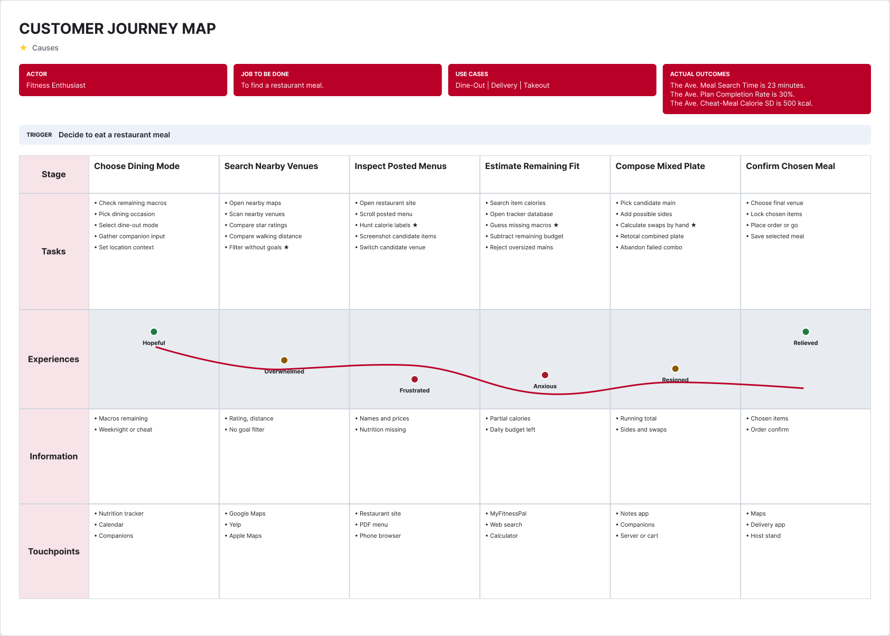
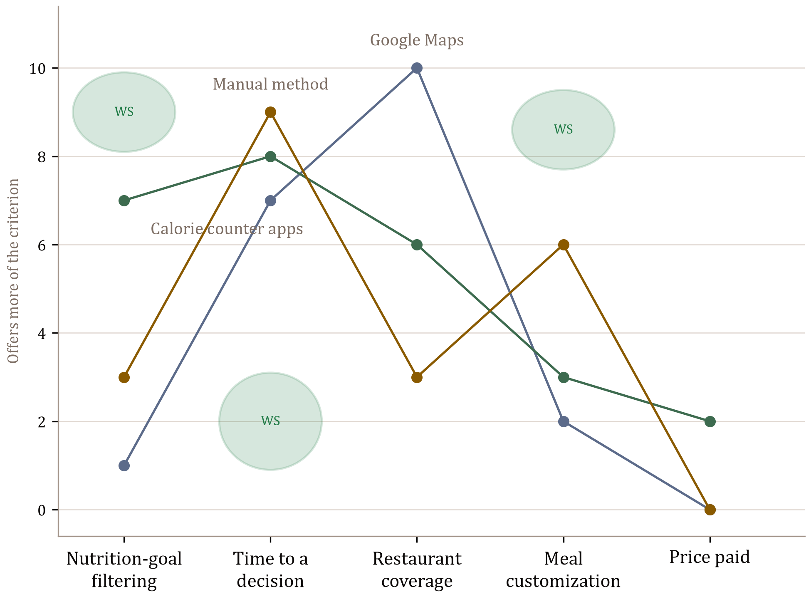
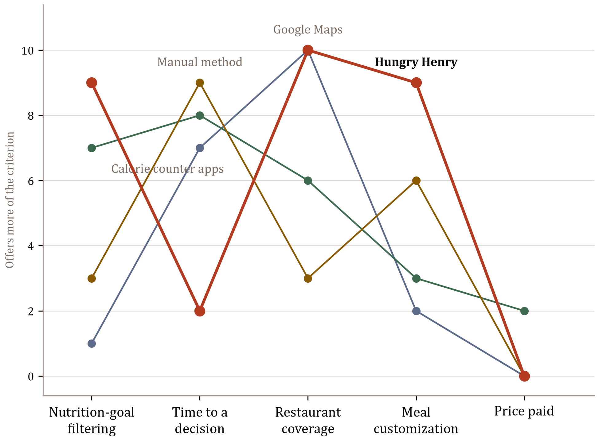
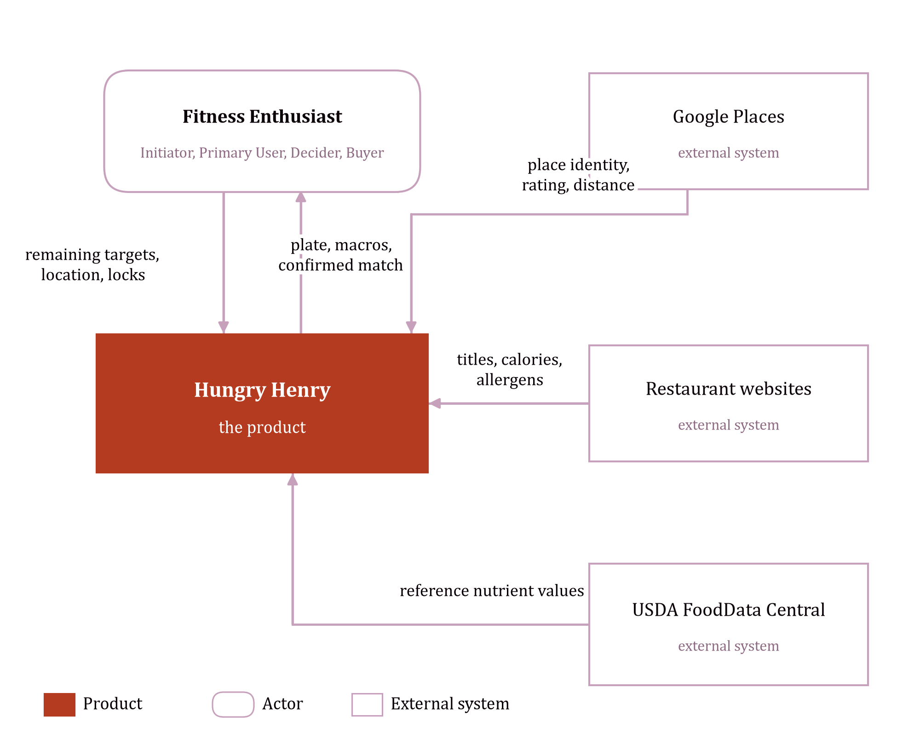

# Product Idea Workbook

**Product:** Hungry Henry
**Prepared by:** Alexander Voller
**Course:** 17-629 Product Management Essentials II
**Document version:** 1.1
**Date:** 3 November 2026

## Version History

| Version | Date | Change |
| --- | --- | --- |
| 1.0 | 2026-10-07 | Initial document for Product Management Essentials I. |
| 1.1 | 2026-11-03 | Rolling updates for Product Management Essentials II. |

## Table of Contents

Word builds this from the headings below. The field refreshes on open, so the
section and page numbers are accurate in the submitted file.

## Executive Summary

Hungry Henry is an iPhone app that builds a restaurant meal to the nutrition a Fitness Enthusiast has left for the day. That search takes 23 minutes today and should take 1. Across 72 restaurant meals a year, 55 percent blow the plan or go untracked — 3.2 billion such meals a year in America.[1][2][13]

**Strategy.** Enter through Macro-Tracking Dine-Out Regulars, the 9.1 million people who already log macros and already eat out, and own the two positions no current option holds: nutrition-goal filtering, and a decision in about a minute. Grow horizontally into delivery, takeout and home cooking, funded by restaurants paying to be seen so the core stays free.

**Go to market.** iOS first, in US launch metros. Reach comes from social network effects and viral collaborations with the restaurants themselves.

**Business impact.** 91,125 users and 2,940 paid memberships by the end of year three, inside a named market of 81 million and a $9.72 billion total addressable market.

**Key risks.** Menu coverage is the binding constraint. What a restaurant will pay to be seen is unknown, and so is whether $10 a month for the paid tier is a price the market will accept. The advantage is not defensible until the data pipeline accumulates.

**Next steps.** Develop from 1 January 2027, introduce January 2028, and expand into delivery and takeout in 2029.

## Product Idea Brief

This brief proposes **Hungry Henry**, an iPhone application that finds restaurant meals which fit a nutrition plan, and seeks executive support to establish whether it can become a differentiated and durable product.

**The problem.** A person who keeps a fitness or nutrition plan cannot readily find a restaurant meal that fits it. Discovery tools rank venues by rating, distance, cuisine and price rather than by a personal target. Most restaurants post names and prices rather than a nutrition record. The arithmetic of combining a main, a side and a substitution is therefore left to the diner at the table. Rigid eating does not survive that friction for long: new dieters in the United States persist roughly three to five weeks before dropping off.[6] The measurable cost is a search that takes 23 minutes where one would do, a weekly plan finished 30 percent of the time rather than 75, and a cheat meal that scatters 500 kcal around the calories still available rather than 150. Across 72 restaurant occasions a year, 55 percent blow the plan or go untracked: 39.6 such meals per person, and 3.2 billion a year among the 81 million Americans who belong to a fitness facility.[1][2][13]

**The proposed solution.** Hungry Henry composes the meal before the order rather than logging the dish after it. Search and Discovery returns meals from nearby restaurants that already sit inside the nutrition still available that day, searchable by food, by restaurant name or on the map, with diet and allergy requirements removing everything that does not qualify. Items can be swapped, added and removed across starters, mains and desserts while the total is scored against the goal in real time. A matched meal saves to a collection, opens directions to the venue, and produces a graphic built for sharing. Ask Henry, the paid engine, chooses the meal outright in ten seconds and can be asked for something new or something in season. The first version addresses the sit-down occasion for the person who already tracks macros closely, because that is where a posted menu does the most damage.

**The market opportunity.** The named market is the 81 million Americans who belong to a fitness facility, a population that grew 5.2 percent between 2024 and 2025.[2] Were each to hold the paid membership for a year at $120, the total addressable market would be $9,720,000,000 and 81 million memberships; the figure assumes universal purchase and excludes restaurant visibility fees, which are the primary revenue line. No current option occupies the position Hungry Henry intends to hold. Google Maps covers the restaurants but does not choose the meal, and calorie counter applications record a dish once it has already been chosen. Both leave the 23-minute search intact.

**The value proposition.** Finding the meal is free, because the search is the job the product exists to do and a fee should not sit on it. Against today's search the free product returns 22 minutes on every restaurant meal, 26.4 hours a year, worth $528 at $20 an hour, against a one-time setup cost of $3.33 — a ratio of roughly 159 to 1.[1] The paid plan is $10 per month and adds Ask Henry and saved target templates, which together put a meal in front of the Fitness Enthusiast in ten seconds, every time; measured against today it returns $548 a year against $120, a ratio of about 5 to 1. Both are low-friction decisions, and low friction is compelling at about 3 to 1.

## 1. Customer Problem Space

### 1. Fertile Land

Restaurants

### 2. Actor

**Fitness Enthusiast**

A Fitness Enthusiast is a person actively pursuing a fitness or nutrition plan who still wants to eat restaurant meals, and who is at risk of abandoning that plan when menus do not show how a meal fits their targets.

The Fitness Enthusiast initiates, uses, decides, and buys the consumer product. The Restaurant Operator buys the listing tiers.

### 3. Job To Be Done

To find a restaurant meal.

<!-- landscape -->

### 4. Outcomes

| Outcome idea                   | Metric                     | Actual Outcome                              | Desired Outcome                                  | Measurement Method                                                                                                                                                                                                                                                                                                                                                                                                                                  |
| ------------------------------ | -------------------------- | ------------------------------------------- | ------------------------------------------------ | --------------------------------------------------------------------------------------------------------------------------------------------------------------------------------------------------------------------------------------------------------------------------------------------------------------------------------------------------------------------------------------------------------------------------------------------------- |
| Faster meal find               | Ave. Meal Search Time      | The Ave. Meal Search Time is 23 minutes.    | The Ave. Meal Search Time will be 1 minute.     | **Calculate:** minutes from the trigger (decide to eat a restaurant meal) to a confirmed item selection, averaged across occasions. Actual = 14 minutes selecting a restaurant + 9 minutes deciding what to order once seated.[1] Units: minutes per occasion.                                                                                                                                                                                      |
| Broken mundane nutrition cycle | Ave. Plan Completion Rate  | The Ave. Plan Completion Rate is 30%.       | The Ave. Plan Completion Rate will be 75%.       | **Calculate:** `(weekly cycles finished ÷ weekly cycles started) × 100`. A cycle is finished if the Actor logs through the week's last planned day without abandoning the plan. Units: percent. _(assumption: actual 30% is informed by Helander et al. 2020 — new January dieters persist about 3.1–5.3 weeks, so most intended weekly cycles in a longer plan are not finished;[6] desired 75% is 45 percentage points above that DIY baseline.)_ |
| Less next-day guilt            | Ave. Cheat-Meal Calorie SD | The Ave. Cheat-Meal Calorie SD is 500 kcal. | The Ave. Cheat-Meal Calorie SD will be 150 kcal. | **Calculate:** sample SD of caloric deviation on cheat meals, `SD = sqrt(Σ(d_i - d_mean)² / (n - 1))`, then averaged across Actors. `d_i` = calories of cheat meal _i_ - the Actor's remaining calorie target for that meal. Units: kcal. Actual 500 kcal is the spread when the meal is guessed from a posted menu _(assumption)_. Desired 150 kcal is a tight enough band around the intended cheat that the meal reads as guilt-free.                |

**Outcome 1 — Faster meal find** (`Ave. Meal Search Time`)

- Actual Outcome Statement: The Ave. Meal Search Time is 23 minutes.
- Desired Outcome Statement: The Ave. Meal Search Time will be 1 minute.
- Measurement Method: minutes from trigger to confirmed item selection, averaged across occasions. Units: minutes per occasion. Source: US Foods.[1]

**Outcome 2 — Broken mundane nutrition cycle** (`Ave. Plan Completion Rate`)

- Actual Outcome Statement: The Ave. Plan Completion Rate is 30%.
- Desired Outcome Statement: The Ave. Plan Completion Rate will be 75%.
- Measurement Method: `(weekly cycles finished ÷ weekly cycles started) × 100`. Units: percent. Source: Helander et al. 2020.[6]

**Outcome 3 — Less next-day guilt** (`Ave. Cheat-Meal Calorie SD`)

- Actual Outcome Statement: The Ave. Cheat-Meal Calorie SD is 500 kcal.
- Desired Outcome Statement: The Ave. Cheat-Meal Calorie SD will be 150 kcal.
- Measurement Method: `SD = sqrt(Σ(d_i - d_mean)² / (n - 1))` of cheat-meal caloric deviations from the remaining target. Units: kcal. _(assumption: actual 500 kcal; desired 150 kcal.)_

<!-- portrait -->

### 5. Customer Journey Map

How a Fitness Enthusiast finds a restaurant meal today.

<!-- landscape -->



<!-- portrait -->

| Layer       | Choose Dining Mode                                                                                               | Search Nearby Venues                                                                                         | Inspect Posted Menus                                                                                                | Estimate Remaining Fit                                                                                                 | Compose Mixed Plate                                                                                              | Confirm Chosen Meal                                                          |
| ----------- | ---------------------------------------------------------------------------------------------------------------- | ------------------------------------------------------------------------------------------------------------ | ------------------------------------------------------------------------------------------------------------------- | ---------------------------------------------------------------------------------------------------------------------- | ---------------------------------------------------------------------------------------------------------------- | ---------------------------------------------------------------------------- |
| Tasks       | Check remaining macros; Pick dining occasion; Select dine-out mode; Gather companion input; Set location context | Open nearby maps; Scan nearby venues; Compare star ratings; Compare walking distance; Filter without goals * | Open restaurant site; Scroll posted menu; Hunt calorie labels *; Screenshot candidate items; Switch candidate venue | Search item calories; Open tracker database; Guess missing macros *; Subtract remaining budget; Reject oversized mains | Pick candidate main; Add possible sides; Calculate swaps by hand *; Retotal combined meal; Abandon failed combo | Choose final venue; Lock chosen items; Place order or go; Save selected meal |
| Experiences | Hopeful                                                                                                          | Overwhelmed                                                                                                  | Frustrated                                                                                                          | Anxious                                                                                                                | Resigned                                                                                                         | Relieved                                                                     |
| Information | Macros remaining; Weeknight or cheat                                                                             | Rating, distance; No goal filter                                                                             | Names and prices; Nutrition missing                                                                                 | Partial calories; Daily budget left                                                                                    | Running total; Sides and swaps                                                                                   | Chosen items; Order confirm                                                  |
| Touchpoints | Nutrition tracker; Calendar; Companions                                                                          | Google Maps; Yelp; Apple Maps                                                                                | Restaurant site; PDF menu; Phone browser                                                                            | MyFitnessPal; Web search; Calculator                                                                                   | Notes app; Companions; Server or cart                                                                            | Maps; Delivery app; Host stand                                               |

* Causes — starred tasks are the contributing causes in Section 1.6.

### 6. Problem

#### Gap

| Metric                     | Desired   | Actual     | Gap (Desired - Actual)        |
| -------------------------- | --------- | ---------- | ----------------------------- |
| Ave. Meal Search Time      | 1 minute | 23 minutes | 22 minutes extra per occasion |
| Ave. Plan Completion Rate  | 75%       | 30%        | 45 percentage points          |
| Ave. Cheat-Meal Calorie SD | 150 kcal  | 500 kcal   | 350 kcal wider spread         |

Fitness Enthusiasts cannot find a restaurant meal that fits their nutrition targets without a long manual search, because restaurants post menus rather than nutrition, discovery products do not filter by personal goals, and substitutions are left to mental math.

#### Causes

**Root cause.** No product treats the Actor's personal nutrition targets as a filter on restaurant meal discovery, so the matching step between "what is on this menu" and "what I should eat" is left to the Actor.

**Contributing causes** (each starred on the current-state map):

1. **Filter without goals** (Search Nearby Venues). Google Search and other food products do not filter by a user's personal nutrition goals.
2. **Hunt calorie labels** (Inspect Posted Menus). Restaurants post menus, not nutrition.
3. **Guess missing macros** (Estimate Remaining Fit). Where a calorie figure exists it is often incomplete; protein, carbs, fat and allergens are missing, so the Actor guesses.
4. **Calculate swaps by hand** (Compose Mixed Plate). Meal substitutions and course selection require logic not implemented on restaurant websites.

### 7. Use Cases

1. **Dine-Out** — The Actor sits down at a restaurant and must choose a venue and a meal before ordering.
2. **Delivery** — The Actor orders a restaurant meal to a home or gym and must choose from marketplace menus without seeing the food.
3. **Takeout** — The Actor picks up a restaurant meal and must choose items that will travel, still inside the nutrition target.

### 8. Problem Sizing

Selected problem: **Cheat-Meal Guilt Problem** — restaurant meals that blow the nutrition plan or go untracked. The size is the number of those meals.

Frequency of the JTBD: 72 restaurant-meal occasions per Actor per year (`assumption:` 6 occasions per month, slightly below the US Foods preference of about 8 restaurant occasions per month).[1] Number of Actors: 81 million Fitness Enthusiasts in the United States, using 2025 US fitness-facility membership as the aligned published proxy.[2] Share of those occasions that are a blow-out or untracked meal: 55%, from the client's pitch that 55% of restaurant patrons trying to lose weight feel guilty the next day.[13] (`assumption:` one guilty occasion = one blow-out or untracked meal.)

**Per instance**

`1 restaurant occasion × 0.55 = 0.55 blow-out or untracked meals per occasion`

**Annualized per actor**

`0.55 meals/occasion × 72 occasions/year = 39.6 blow-out or untracked meals/year per Fitness Enthusiast`

**Total impact, annually (America)**

`39.6 meals/year × 81,000,000 Fitness Enthusiasts = 3,207,600,000 blow-out or untracked meals/year`

That is **3.2 billion blow-out or untracked restaurant meals per year in America.**

The other gaps:

- Search time: `23 minutes - 1 minute = 22 minutes` extra per occasion; `22 × 72 = 1,584 minutes` (26.4 hours) per Actor per year; `26.4 × 81,000,000 = 2.14 billion hours/year`.[1][2]
- Plan completion: `75% - 30% = 45 percentage points` each weekly cycle. `52 × 30% = 15.6` weeks finished today; `52 × 75% = 39` weeks at the desired rate. The gap is 23.4 unfinished weeks per Actor per year (`assumption:` weekly cycle).[6]
- Cheat-meal calorie SD: `500 kcal - 150 kcal = 350 kcal` wider spread per cheat occasion (`assumption:`).

### 9. Problem Category

Meal Search Problem

### 10. Problem Statement

Fitness Enthusiasts want restaurant meals that stay on their nutrition plan, but restaurants post menus rather than nutrition and discovery tools do not filter by personal goals. Consequently 55% of restaurant occasions blow the plan or go untracked — 39.6 such meals per Actor per year, **3.2 billion blow-out or untracked meals per year in America** across the 81 million people who match the Actor.

## 2. Market Space

### 1. Overall Market

**US Fitness Enthusiast Dining-Out Market** — everyone who matches the Actor and does the JTBD.

Number of Actors: **81 million** in the United States (2025 fitness-facility members). The published figure is membership, not a self-label of "Fitness Enthusiast"; it is the closest aligned count for people in a structured fitness practice. Total facility users, including non-members, exceeded 100 million in 2025.[2]

Trend: **growing.** Membership rose 5.2% from 2024 to 2025, and 20% from 2019 to 2024, as fitness facilities moved from amenity to health infrastructure.[2][3] More people in a plan means more occasions on which a restaurant meal can break that plan.

### 2. Total Addressable Market (TAM)

The price is the paid membership, $10 per member per month, $120 a year. The actor count is 81 million.[2]

`TAM (revenue) = 81,000,000 Fitness Enthusiasts × $120 per member per year = $9,720,000,000 per year`

`TAM (units) = 81,000,000 memberships per year`

Every member of the named market buying Paid is the assumption that makes this a ceiling rather than a forecast. Restaurant visibility fees, which Section 5.3 names as the primary revenue line, are excluded.

### 3. Market Segmentation

Go-to meal splits the 81 million Actors. Each person is counted once (`assumption:` primary mode).

| Segmentation Variable | Segment Values | Segment Name      | Segment Size        |
| --------------------- | -------------- | ----------------- | ------------------- |
| Go-to meal            | Dine-Out       | Dine-Out Regulars | 36.45 million (45%) |
| Go-to meal            | Delivery       | Delivery Regulars | 22.68 million (28%) |
| Go-to meal            | Takeout        | Takeout Regulars  | 21.87 million (27%) |

Notes: 45% dine-out as primary mode follows the US Foods finding that dining out holds a slight preference edge (55% vs 45% takeout/delivery) and is then pulled down so the three values sum to the market.[1] The 28% / 27% split of the remaining 55% is `assumption:`.

A second scheme, used to name the beachhead, cuts on nutrition-tracking behaviour:

| Segmentation Variable        | Segment Values                 | Segment Name   | Segment Size        |
| ---------------------------- | ------------------------------ | -------------- | ------------------- |
| Nutrition-tracking intensity | Daily macro log                | Macro Trackers | 20.25 million (25%) |
| Nutrition-tracking intensity | Has a plan, does not log daily | Goal-Aware     | 36.45 million (45%) |
| Nutrition-tracking intensity | Trains, loose nutrition        | Fitness-Only   | 24.30 million (30%) |

Shares in scheme 2 are `assumption:`.

### 4. Target Market Profiles

**Dine-Out Regulars**

| Field        | Value                                                                                               |
| ------------ | --------------------------------------------------------------------------------------------------- |
| Segment name | Dine-Out Regulars                                                                                   |
| Variables    | Go-to meal                                                                                          |
| Values       | Dine-Out                                                                                            |
| No. Actors   | 36.45 million                                                                                       |
| Growth       | Growing with sit-down recovery; dine-in preference rose versus 2023 in the US Foods diner study.[1] |

They share one occasion, diner studies size them, and they already open Maps at the table.

**Delivery Regulars**

| Field        | Value                                                                                           |
| ------------ | ----------------------------------------------------------------------------------------------- |
| Segment name | Delivery Regulars                                                                               |
| Variables    | Go-to meal                                                                                      |
| Values       | Delivery                                                                                        |
| No. Actors   | 22.68 million                                                                                   |
| Growth       | Takeout and delivery weekly use has risen versus 2022 (43% ordering takeout weekly or more).[4] |

Marketplace menus, and no server. The Match still ends the job.

**Macro Trackers**

| Field        | Value                                                   |
| ------------ | ------------------------------------------------------- |
| Segment name | Macro Trackers                                          |
| Variables    | Nutrition-tracking intensity                            |
| Values       | Daily macro log                                         |
| No. Actors   | 20.25 million (`assumption:` 25% of 81 million)         |
| Growth       | Tracker use rides the same fitness-membership trend.[2] |

This is the behaviour that makes nutrition-goal filtering a purchasing criterion. Accessible where they already log food.

### 5. Competition

Frame: a Fitness Enthusiast trying to find a restaurant meal. Options the Actor already perceives.

| Kind     | Option                          | Category            |
| -------- | ------------------------------- | ------------------- |
| Indirect | Google Maps (Google LLC)        | Local search / maps |
| Indirect | Calorie counter apps (category) | Food logging        |
| Indirect | Manual method                   | Substitute          |

None of the three sit in the same product category. There is no widely used product in _nutrition-goal-filtered restaurant meal matching_. That is the white space on the current-state map.

**1. Google Maps (specific product)**

| Field                   | Value                                                                                                                                                                                                                                                       |
| ----------------------- | ----------------------------------------------------------------------------------------------------------------------------------------------------------------------------------------------------------------------------------------------------------- |
| Brand name              | Google Maps                                                                                                                                                                                                                                                 |
| Company                 | Google LLC                                                                                                                                                                                                                                                  |
| Competitive positioning | The complete local map: ratings, distance, photos, and hours for nearly every restaurant, now with Ask Maps conversational discovery. Claimed differentiator is place coverage plus getting the Actor from search to directions without leaving the map.[7] |

Maps finds a venue, not a meal that fits a nutrition target.

**2. Calorie counter apps (product category)**

| Field                        | Value                                                                                                                                                                                                                                                                                                                      |
| ---------------------------- | -------------------------------------------------------------------------------------------------------------------------------------------------------------------------------------------------------------------------------------------------------------------------------------------------------------------------- |
| Product category             | Calorie counter apps                                                                                                                                                                                                                                                                                                       |
| Examples                     | MyFitnessPal — MyFitnessPal, Inc. (Francisco Partners).[8] Lose It! — FitNow, Inc.[9] Cronometer — Cronometer Software Inc.[10]                                                                                                                                                                                            |
| Evidence the category exists | Apple lists the product as _MyFitnessPal: Calorie Counter App_ in Health & Fitness.[8] MyFitnessPal's site answers "Is MyFitnessPal a free calorie tracker app?" with "If you're looking for a free calorie counter app, you're in the right place."[11] Capterra lists the same class as _Calorie Tracking Software_.[12] |

The Actor uses this category to look up a dish after they have already picked a venue. It logs food; it does not assemble a restaurant meal to a remaining target.

**3. Manual method**

Walk in (or open the PDF menu), read item names and prices, and guess the macros. No brand. Most economical. Still a real choice the Actor treats as a way to finish the job.

### 6. Positioning Analysis

Customer evaluation criteria, scored 0–10. Calorie counter apps are the median product in that category.

| Criterion                | What it means                                                                             | Google Maps | Calorie counter apps | Manual method | Hungry Henry (future only) |
| ------------------------ | ----------------------------------------------------------------------------------------- | ----------- | -------------------- | ------------- | -------------------------- |
| Nutrition-goal filtering | How much the option uses the Actor's personal calorie/macro target as a filter            | 1           | 7                    | 3             | 9                          |
| Time to a decision       | How much of the Actor's time the option consumes to reach a chosen meal. Higher = slower. | 7           | 8                    | 9             | 2                          |
| Restaurant coverage      | How many nearby venues the option can show                                                | 10          | 6                    | 3             | 10                         |
| Meal customization       | How far the Actor can lock, swap, and rebuild a meal                                     | 2           | 3                    | 6             | 9                          |
| Price paid               | How much money the option charges the Actor. Higher = more expensive.                     | 0           | 2                    | 0             | 0                          |

Scores are `assumption:` from the customer's point of view, not a survey.

#### Current State Positioning Map

Without Hungry Henry. Green ovals mark significant white space — positions none of the three noteworthy options occupy.



White space called out on the map:

1. **High nutrition-goal filtering** (about 8–10). Calorie counter apps reach 7 by looking up a logged item. Nothing filters the restaurant search itself by the remaining target.
2. **Low time to a decision** (about 1–3). Every current option consumes a long search. The 23-minute actual sits here.
3. **High meal customization** (about 8–10). The manual method can swap sides by hand (6). Nothing locks an item and rebuilds the rest of the meal to the leftover macros.

#### Future State Positioning Map

The current-state map, with Hungry Henry plotted and the white-space ovals removed.



Hungry Henry is placed at 9 on nutrition-goal filtering, 2 on time to a decision, and 9 on meal customization. Those are the three white-space ovals from the current-state map. Restaurant coverage is **10, the same as Google Maps**, because Hungry Henry uses Google place data for distance, rating, and venue identity. Price paid stays 0, same as Maps and the manual method.

#### Position-to-Own

**A restaurant meal matched to your target, without the 23-minute hunt.**

The first product owns two places on the future-state map: **high nutrition-goal filtering** and **low time to a decision**, with meal customization as the supporting move that makes a match picky without restarting the search.

**Tagline:** Find your guilt-free cheat meal.

### 7. Market Focus Decision

**Market coverage strategy.** Differentiated. Go-to meal and tracking intensity change the product. An undifferentiated mass-market restaurant app would recreate Google Maps.

**Market entry strategy.** First segment: **Dine-Out Regulars** (36.45 million) — largest go-to-meal segment, growing with sit-down recovery, and a low entry barrier because the Actor already opens Maps at the table.[1] First niche: **Macro-Tracking Dine-Out Regulars** (~9.1 million if the 25% tracker share is applied to the dine-out segment; `assumption:` independence) — they already pay for a calorie counter app, so nutrition-goal filtering is a criterion they use today, and they can be reached where they already log. First use case: **Dine-Out** — highest pain on the current-state journey. First problem: **Cheat-Meal Guilt Problem** — 3.2 billion blow-out or untracked restaurant meals per year in America. First position-to-own: high nutrition-goal filtering and low time to a decision. v1 is designed for this group.

**Market growth strategy.** TBA.

## 3. Solution Space

### 1. MVP Product Concept Outline

Hungry Henry v1.0 serves one market focus: the Dine-Out Regulars segment, the Macro-Tracking Dine-Out Regulars niche, the Dine-Out use case, and the Cheat-Meal Guilt Problem. The positions to own are high nutrition-goal filtering and low time to a decision.

**Product Name:** Hungry Henry

**Purpose:** To find a restaurant meal.

**Product Category:** Calorie Counter Apps. Existing category. Evidence: Apple lists _MyFitnessPal: Calorie Counter App_ in Health & Fitness;[8] MyFitnessPal answers "Is MyFitnessPal a free calorie tracker app?" on its homepage;[11] Capterra lists the class as _Calorie Tracking Software_.[12] Hungry Henry is filed here because the Actor already opens this class to check a restaurant dish. Differentiation is inside the category: Henry builds the meal to the remaining target before the meal, rather than logging a dish after it.

**Main Attributes:**

- **Search and Discovery** — return meals from nearby restaurants that sit inside the remaining energy, protein, carb and fat target, searchable by food, by restaurant name or on the map, with diet and allergy requirements excluding everything that does not qualify, and each meal carrying its venue, rating and distance.
- **Edit meals** — swap, add and remove items across starters, mains and desserts while the total is scored against the goal in real time.
- **Get directions** — open directions to the venue in Google from a matched meal.
- **Match** — confirm the meal that will be eaten, and save it to the list.
- **Save for later** — curate collections of pre-selected meals.
- **Share** — produce a summary graphic for a matched meal, built to be overlaid onto an Instagram story.
- **Review** — leave a star rating and notes on a restaurant for other Fitness Enthusiasts.
- **Target templates** — save preset nutrition values as named templates and start a search from one of them. Paid.
- **Standard GenAI** — Ask Henry: a sentence becomes a meal, with *try something new* and *in-season* toggles. Paid.

These are the v1 capabilities. Search and Discovery creates the position-to-own: a goal filter and a one-minute path to a chosen meal. Restaurant listing tiers and delivery checkout are outside this outline.

**Software Deliverables:** iOS app

**Physical Deliverables:** none

**Input/Output Methods:** touchscreen; visual display; GPS

**Production Infrastructure:** public cloud

**Product Data:**

- **Sources** — Google Places (place identity, rating, distance); restaurant menus (titles, calories, allergens where posted); USDA FoodData Central (reference nutrient values when a menu line is incomplete).
- **Completeness** — Places is sufficient for venue identity. Menus are often names and prices only; missing macros must be estimated or listed by the operator.
- **Timeliness** — Places is a live lookup. Menus are static until the operator updates them or the ingest is refreshed. FoodData Central is updated on USDA's release cycle, not per order.
- **Usage** — Places under Google Maps Platform terms. FoodData Central is public domain (USDA requests attribution). Menu text is taken from public postings or from the operator's listing.
- **Technical** — Places and FoodData Central over HTTPS as JSON. Menu items are stored as structured records (title, optional course, energy, protein, fat, carbs, allergen).

### 2. User Views

Dine-Out. A confirmed meal in about 1 minute, near the remaining target.

1. **Start Hungry Henry on an iPhone.** The product opens on Filters, with energy, protein, carbs, and fat off.
2. **Set the remaining target.** Turn energy on and choose _less_ with a kcal value; turn protein on and choose _more_ with a gram value; turn on one diet or allergy (for example pescatarian or shellfish). The product stores those targets and marks the rows on.
3. **Leave Filters for Home.** The product generates a meal from a nearby restaurant: restaurant name, Google stars, and distance at the top; a stacked list of foods (name, optional course, kcal and protein); a macro row for energy, protein, carbs, and fat with a hit or a plus/minus diff; diet or allergy pills under the macros. Large Forward and Match buttons sit under the meal.
4. **Lock a food already wanted** (tap that food's title). The product marks the food locked, locks the restaurant with it, and keeps that item's nutrition constant.
5. **Tap Forward.** The product bumps unlocked foods out and new foods in, one by one. The locked food stays. The macro row updates against the same target.
6. **Tap Match.** The product records that the Fitness Enthusiast will eat this meal and shows the chosen foods and the final macros. A Share control on that screen sends the confirmed meal. The job is finished.

Entry point: open the iOS app after deciding to eat a restaurant meal. Completion point: Match — a confirmed meal, no checkout.

### 3. Functional Requirements

| No. | Feature | Requirement |
| --- | --- | --- |
| 1 | Search and Discovery | As a Fitness Enthusiast, I want to set energy to less, is, or more of a kcal value so that each meal is judged against the energy I have left. |
| 2 | Search and Discovery | As a Fitness Enthusiast, I want to set protein to less, is, or more of a gram value so that each meal is judged against the protein I still want. |
| 3 | Search and Discovery | As a Fitness Enthusiast, I want to set carbs to less, is, or more of a gram value so that each meal is judged against the carbs I have left. |
| 4 | Search and Discovery | As a Fitness Enthusiast, I want to set fat to less, is, or more of a gram value so that each meal is judged against the fat I have left. |
| 5 | Search and Discovery | As a Fitness Enthusiast, I want to turn on a diet so that meals exclude foods that break that diet. |
| 6 | Search and Discovery | As a Fitness Enthusiast, I want to turn on an allergy so that a meal that contains that allergen is not presented as a match. |
| 7 | Search and Discovery | As a Fitness Enthusiast, I want a meal generated from one nearby restaurant so that I can see a meal that meets, or is close enough to, my remaining targets. |
| 8 | Search and Discovery | As a Fitness Enthusiast, I want the meal to name the restaurant so that I know where the meal is. |
| 9 | Search and Discovery | As a Fitness Enthusiast, I want the meal to show the restaurant's star rating so that I can judge the venue before I match. |
| 10 | Search and Discovery | As a Fitness Enthusiast, I want the meal to show distance from me so that I know how far the restaurant is. |
| 11 | Edit meals | As a Fitness Enthusiast, I want each food on the meal named with its energy and protein so that I can see what I would eat. |
| 12 | Edit meals | As a Fitness Enthusiast, I want the meal compared to my remaining energy, protein, carbs, and fat so that I can see a hit or a plus/minus before I match. |
| 13 | Edit meals | As a Fitness Enthusiast, I want to lock a food on the meal so that later meals keep that food. |
| 14 | Edit meals | As a Fitness Enthusiast, I want the restaurant locked when I lock a food so that later meals stay at that restaurant. |
| 15 | Edit meals | As a Fitness Enthusiast, I want unlocked foods replaced with different foods from the same restaurant so that I can try another combination against the same remaining target. |
| 16 | Match | As a Fitness Enthusiast, I want to confirm the meal I will eat so that the search ends on a chosen meal. |
| 17 | Share | As a Fitness Enthusiast, I want the confirmed meal sent to another person so that they can see the meal I will eat. |
| 18 | Ask Henry | As a Fitness Enthusiast, I want a sentence I type turned into a meal so that I can skip reading posted menus. |
| 19 | Get directions | As a Fitness Enthusiast, I want directions to the venue opened in Google from a matched meal so that I can get there without searching for it again. |
| 20 | Save for later | As a Fitness Enthusiast, I want to save a meal into a collection so that I can find it again on another occasion. |
| 21 | Review | As a Fitness Enthusiast, I want to leave a star rating and notes on a restaurant so that other Fitness Enthusiasts know what to expect. |
| 22 | Target templates | As a Fitness Enthusiast, I want to save a set of nutrition targets under a name so that I can start a later search from it instead of setting each value again. |

### 4. Context View



### 5. Non-Functional Requirements

| No. | Kind | Requirement                                                                                                                                                                                                                              | Feature                    |
| --- | ---------------- | ---------------------------------------------------------------------------------------------------------------------------------------------------------------------------------------------------------------------------------------- | -------------------------- |
| 1 | Latency | When Hungry Henry opens on the happy path, latency shall be ultra-low (less than 2 ms) so that the first screen feels instantaneous. | Search and Discovery |
| 2 | Latency | When initial options are returned after a search, latency shall not exceed medium (200 ms to 1 second). | Search and Discovery |
| 3 | Latency | When new meal options are presented, latency shall be low (2 to 200 ms) so that the next meal feels instantaneous. | Edit meals |
| 4 | Usability | Hungry Henry shall enable a first-time Fitness Enthusiast to confirm a meal within 1 minute without prior instruction. | Match |
| 5 | Availability | The product shall be available 99.9% of the year. |  |
| 6 | Compatibility | The iOS app shall operate on iPhone running the current iOS release and the two previous major releases (N-2). |  |
| 7 | Security | The product shall enforce a medium-level of security to minimize risk from organized hacker groups. |  |
| 8 | Privacy | The product shall have a medium-level of data privacy as it contains PII (location, remaining targets, diet, allergy) that may fall under CCPA/CPRA or similar state privacy laws and does not contain actionable financial information. |  |
| 9 | Accuracy | When a menu line posts energy, the meal shall display that posted kcal value for 100% of such lines. | Advanced Math Computations |
| 10 | Accuracy | When energy is taken from USDA FoodData Central, the meal shall mark the value as estimated. | Advanced Math Computations |
| 11 | Safety | The product will operate in situations where failures could lead to injuries or moderate environmental damage. | Allergy constraint |
| 12 | Safety | When a menu line posts an allergen, the meal shall display that allergen. | Allergy constraint |
| 13 | Interoperability | Hungry Henry shall get place identity, rating, and distance from Google Places. | Location and Mapping |
| 14 | Interoperability | Hungry Henry shall get item titles, posted calories, and posted allergens from restaurant websites. | Search and Discovery |
| 15 | Interoperability | Hungry Henry shall get reference nutrient values from USDA FoodData Central when a menu line is incomplete. | Advanced Math Computations |## 4. Customer Value Space

### 1. Product Features and Benefits

Benefits are measured against the current state: Google Maps and posted menus.

| Feature | Benefit(s) |
| --- | --- |
| Search and Discovery | The primary feature. Ave. Meal Search Time falls from 23 minutes to 1 minute — 22 minutes saved per occasion.[1] Search by food, by restaurant name, or on the map, with every suggestion already inside the nutrition range still available. Diet and allergy requirements remove the rest of the noise, so only valid meals are shown, each with its venue and distance. |
| Edit meals | Swap, add and remove items across starters, mains and desserts while the total nutrition is scored against the goal in real time, so a picky meal does not restart the search. |
| Get directions | Match a meal and open directions to the venue in Google, so the admin after the decision does not undo the time the search saved. |
| Match | Confirm the meal that will be eaten. It is saved to the list, so it can be found again. |
| Save for later | Curate lists of pre-selected meals into the Fitness Enthusiast's own collections, so a known-good meal is one tap away on the next occasion. |
| Share | Send a find to social media and promote sustainable eating. Every match produces a summary graphic built to be overlaid on an Instagram story. |
| Review | Leave a star rating for a restaurant, and anything else a fellow Fitness Enthusiast would find useful. |
| Target templates | Paid. Save preset nutrition values as named templates — a "midday baseline", a "training day cheat" — and start a search from one tap instead of setting four macros. The saving compounds across repeated searches, and it is what keeps the paid search at ten seconds on every occasion rather than only the first. |
| Ask Henry | The paid feature. Ave. Meal Search Time falls again, from 1 minute to 10 seconds, for the Fitness Enthusiast who wants the meal immediately. Its *try something new* and *in-season* toggles surface meals they have not had before, which is what breaks the mundane cycle: Ave. Plan Completion Rate from 30% to 75% (`assumption:`). |

### 2. Pricing Model

Restaurants pay to be seen. That price is not set here.

**Price-setting strategy.** Segmented, with two tiers. Free is the core product and the anchor. Paid buys one thing: Ask Henry.

| Tier | Who it is for | Bundle | Price | Metric |
| --- | --- | --- | --- | --- |
| Free (anchor) | Everyone. The full search finishes the job. | Search and Discovery by food, restaurant or map, inside the nutrition range, with diet and allergy filters. Edit meals, Get directions, Match, Save for later, Share, Review. | $0 | per member |
| Paid (core offer) | Wants the meal immediately, every time, and wants to be shown something new. | Everything in Free, plus Ask Henry — the tailored recommendation engine, with *try something new* and *in-season* toggles — and saved target templates. | $10 per month | per member |

**Pricing metric.** One Fitness Enthusiast's access, per month.

**Price.** Free is $0. Search and Discovery already takes the search from 23 minutes to 1 minute, and a fee should not sit on the job the product exists to do.

Paid is $10 per member per month, $120 a year. Ask Henry chooses the meal itself and answers in 10 seconds; a saved target template removes the set-up step, so those 10 seconds hold on every repeat occasion rather than only the first.

```
Value against today's search = (23 min - 10 sec) / 60 × 72 occasions × $20/hour
                             = 22.83 / 60 × 72 × $20
                             = $548 per year     (`assumption:` $20 per hour)
```

Google Maps, how the meal is found today, costs $0, so this job has no paid reference price.[7]

**What Paid is not sold on.** Measured against Free rather than against today, the paid tier saves 50 seconds per occasion — one hour a year, worth $20. That does not pay for $120 on time alone. The rest of the case is repeatability, which the saved templates give, and variety, which the *try something new* and *in-season* toggles give. Both target the plan-completion outcome in Section 1.4 rather than the time outcome, and neither is valued in money here. Willingness to pay $10 a month is the open question (ASM-030).

**Payment structure.** Free has no charge. Paid is charged monthly to the Fitness Enthusiast, by card or the app store, and stops when it is cancelled.

### 3. Customer Cost Items

**Acquiring.** Paid is $10 per month. Free is $0. No shipping, and no new phone (`assumption:` the iPhone is already owned).

**Using.** Setting the nutrition targets takes 10 minutes once: `10 / 60 × $20 = $3.33` in the first year (`assumption:`). That setup is on Free.

**Having.** The $10 recurs monthly and buys Ask Henry. Stopping payment returns the account to Free, which still finds the meal. Location, nutrition targets, saved meals and collections stay on the account; that privacy cost has no dollar figure. No accessory and no second app are required.

**Disposing.** Cancel at any month end. No cancellation fee. Delete the app. No disposal charge.

### 4. Customer Value Proposition Evaluation

**The offer is a restaurant meal that fits the goal, in ten seconds.** The same meal takes 23 minutes to find today.

On Free the search takes a minute, and the benefit is the 22 minutes already sized — $528 a year against a one-time setup of $3.33.

```
Free ratio = $528 / $3.33 = 158.6
```

On Paid, Ask Henry chooses the meal and answers in ten seconds, and a saved target template removes the set-up step so those ten seconds hold on every occasion. Against today's search that is $548 a year against $120.

```
Paid ratio = $548 / $120 = 4.6
```

Both clear the bar. Low friction is compelling at about 3:1, and both offers are a small amount of money, a decision made in minutes, and easy to stop.

The honest qualification is that Paid only clears against *today's* search. Measured against Free, which the Fitness Enthusiast already has, the paid tier adds $20 a year of time against a $120 fee. It therefore rests on repeatability and on variety — a meal they would not have found alone — which target the plan-completion outcome and carry no dollar figure here. Free remains the right plan whenever the one-minute search is enough.

The other benefits in the features table stand and are not summed in money: cheat-meal scatter from 500 kcal to 150 kcal, and a plan finished 75 percent of the time rather than 30 percent.

## 5. Product Strategy Space

### 1. Product Goals

By the end of year 3, Hungry Henry reaches 1% of Macro-Tracking Dine-Out Regulars: 9,112,500 Fitness Enthusiasts (`assumption:` dine-out share independent of the 25% daily-log share).[2] That niche is a Major segment. The class benchmark at three years is 0.2% to 1% (17-629, Class 1).[14] The high end is used because switching cost is low at entry, the price to adopt is $0 since the whole search sits on Free, and no current option filters a restaurant search by a personal target. The 1% point is `assumption:`.

`EOY 3 total users = 0.01 × 9,112,500 = 91,125`

Growth is constant progression: the same number of new users arrives each year. In v1, one person's match does not get better because more people have joined.

`EOY 1 total users = 91,125 / 3 = 30,375`

`EOY 2 total users = 2 × 91,125 / 3 = 60,750`

`EOY 3 total users = 91,125`

One membership is one Fitness Enthusiast. A unit sold is one Paid membership for a year. Free memberships are users and are not units sold.

Ask Henry costs money to run, which puts this in the class band of 10 to 30 free users per paying user (17-629, Class 1).[14] Free already finishes the job, so the ratio is taken at the free-heavy end, 30:1 (`assumption:`).

`Paid users = total users / 31`

`Free users = total users - paid users`

`EOY 1 paid = round(30,375 / 31) = 980`; free = 30,375 - 980 = 29,395

`EOY 2 paid = round(60,750 / 31) = 1,960`; free = 60,750 - 1,960 = 58,790

`EOY 3 paid = round(91,125 / 31) = 2,940`; free = 91,125 - 2,940 = 88,185

|                | EOY 1  | EOY 2  | EOY 3  |
| -------------- | ------ | ------ | ------ |
| No. paid users | 980    | 1,960  | 2,940  |
| No. free users | 29,395 | 58,790 | 88,185 |
| Total users    | 30,375 | 60,750 | 91,125 |
| No. units sold | 980    | 1,960  | 2,940  |

Units sold equal paid users.

### 2. Product Vision

> **Hungry Henry will make dieting fun, flexible and achievable: every meal you want, built to fit the goal you are on.**

**Horizon: ten years.**

Ten years from now a Fitness Enthusiast wants the carbonara at the local Italian, the late delivery, or Tuesday night at their own stove, and they get it — delicious, satisfying, and still on the goal — because the meal was built for their taste and for whatever the day has left.

Hungry Henry takes the core pillars it fine-tuned in the restaurant-discovery vertical and expands to cover the food-delivery and home-cooking markets, so a Fitness Enthusiast finds the meal they need whatever their go-to cheat meal is. Food delivery is the Delivery Regulars segment, 22.68 million, with Takeout Regulars a further 21.87 million (Section 2.3). Home cooking sits outside that scheme, because the scheme partitions restaurant occasions only, and reaches the same Fitness Enthusiasts on the nights they do not eat out at all. Together they take the served market from the 36.45 million Dine-Out Regulars of v1.0 to the full 81 million named market, and then past it toward the more than 100 million Americans who used a fitness facility in 2025.[2] At the $120 membership that moves the total addressable market from $9.72 billion to roughly $12.0 billion a year.

The step after that is knowing the nutrition target before the Fitness Enthusiast does. Integrations with new Hungry Henry fitness and nutrition platforms allow micro-nutritional and exercise adjustments that keep them on track, through a suite of features built for flexible eating: caloric banking, and automatic exercise compensation — have the dessert, and the exercise plan is amended to match. Over all of it, Ask Henry becomes a market-leading AI model for fitness and nutrition on the strength of data nobody else holds: taste preferences, nutrition targets, and exercise data itself.

What begins as an iPhone app becomes an end-to-end platform which makes dieting fun, flexible and achievable: every meal you want, built to fit the goal you are on.

#### Product Vision Summary

#### 1. Customer Future

The Fitness Enthusiast stops planning around food and starts checking in with it. The job widens from one restaurant meal to the whole eating week — the meal out, the late delivery, the Tuesday night at their own stove — and the target is met on all three without the arithmetic. Hitting it is rewarded with streaks and achievements, and the wins and the finds are shared.

#### 2. Market Future

Hungry Henry expands to food delivery and home cooking, taking the served market from the 36.45 million Dine-Out Regulars of v1.0 to the full 81 million named market, and then past 100 million once home cooking reaches Fitness Enthusiasts without a facility membership (Section 2.3).[2] Collectively, across food delivery, home cooking and restaurant dining, that is roughly 89 billion meals a year Hungry Henry will present to a Fitness Enthusiast finding a meal (`assumption:` three meals a day across 81 million Actors).

#### 3. Product Future

One iPhone app becomes a product line. **Henry**'s search expands to include home-cooking and food-delivery options, and interfaces to popular food-delivery apps such as DoorDash increase familiarity with users. **Henry Social** turns each match into something worth posting. **Henry Platform** is where a week of meals is planned rather than a single occasion. **Hungry Henry fitness and nutrition platforms** add caloric banking and automatic exercise compensation, so the target itself is managed and not only met. **Ask Henry** sits across all of them as the paid engine.

By EOY 5 the current app is targeted at the EU, Australia and most international markets, vastly increasing the total addressable market.

#### 4. Technology Future

Henry Social keeps on top of the latest social trends and produces graphic summaries built to be overlaid onto Instagram stories, so the product's own distribution is a feature rather than a budget. Henry Platform is a separate desktop and mobile application for planning every meal, not just the next one. Behind Ask Henry sits the exclusive pipeline named in Section 5.3 — taste preferences, nutrition targets and, later, exercise data — which is what a competitor cannot buy. Wearables set the day's remaining target without being asked. At the core of every product: simplicity, a high-quality interface, and an experience that stays friendly and fun.

### 3. Product Strategy

The strategy is **Horizontal Product on a Marketplace Platform**: one search, taken into one market after another, with restaurants paying to be seen so the consumer product stays free. The Ansoff quadrant is **Market Development** — an existing product into a new market.

That choice follows from what the product actually solves. Search time for a Fitness Enthusiast finding a meal is the same problem whether the meal is eaten at a table, delivered, or cooked at home, so the product does not have to be rebuilt to serve a new market. Growth therefore costs less per market than a second product would, and every market added feeds the same data pipeline that Section 5.4 depends on. Three things follow from it:

- **Reach** comes from social network effects and viral collaborations with the restaurants themselves. Every match produces a shareable graphic (Section 4.1), so the product markets itself through its own users and its own B2B partners.
- **Differentiation** comes from the resulting data — meals matched, targets set, tastes revealed — which is an exclusive pipeline no competitor can buy. Ask Henry is built on it, so the paid product improves as the free product is used.
- **Retention and cost** come together. Lifetime data raises the switching cost, because previous meals, saved lists and saved preferences are lost on leaving. The B2B model keeps the core free, so a me-too entrant arriving later with a paid consumer app has to match a price of zero while carrying the same infrastructure.

**Strategic move 1 — horizontal growth into new markets.** A new market with the same product. After v1.0 succeeds with Macro-Tracking Dine-Out Regulars, search goes to the Delivery and Takeout segments — 22.68 million and 21.87 million Fitness Enthusiasts against 36.45 million at entry (Section 2.3) — then to home cooking, and by EOY 5 to the EU, Australia and most international markets.

The move is chosen because both advantages scale with users rather than with depth. The data pipeline behind Ask Henry and the switching cost built from lifetime data are only worth anything at volume, so the first priority is the user base that produces them. Minor technology and API work is needed to interface to home-cooking websites and food-delivery platforms such as DoorDash, but the core offering — reduce search time for Fitness Enthusiasts — does not change, and neither does the revenue model, which is already proven on the restaurant side by then.

The viable alternative was a new product for the same diners, a deeper restaurant or operator tool. It would strengthen one market rather than widen the base, which is the wrong order: depth without volume leaves the data thin and the switching cost low, and a well-funded competitor copying the interface would face no moat. It stays on the table as a later option, not a first move.

What is unknown: whether delivery and takeout menus can be ingested at the coverage dine-out needs; whether the viral loop produces users fast enough to keep restaurants paying; what a restaurant will pay to be seen, which Section 4.2 leaves open; and whether the data advantage compounds before the interface is copied. The main disadvantage is that each new market multiplies the menu-coverage problem instead of deepening the one already covered.

**Strategic move 2 — new products for the enlarged market.** Once the markets are taken, Product Augmentation: the Hungry Henry fitness and nutrition platforms, adding caloric banking and automatic exercise compensation so the nutrition target is managed rather than only met, and Ask Henry grown into a market-leading model on the strength of the taste, nutrition and exercise data nobody else holds. This is the move the first one exists to make possible, and it is worth more after the user base is built than before it.

### 4. Advantage

| Source | How it is created |
| --- | --- |
| Network effects | Every match produces a shareable graphic, and restaurants promote the product that brings them diners. Reach grows from use rather than from spend. |
| Proprietary data | Meals matched, targets set and tastes revealed are an exclusive pipeline. Ask Henry is built on it, so the paid product cannot be copied without the data. |
| Switching costs | Previous meals, saved lists and saved preferences are lifetime data. Leaving means rebuilding the tailored experience from nothing. |
| Cost advantage | Restaurants fund the product, so the Fitness Enthusiast pays nothing for the core. A later entrant has to match a price of zero. |

**Sustainability test**

1. **Is the customer value strong?** Yes. 22 minutes saved on every restaurant meal, worth $528 a year, against 3.2 billion blow-out or untracked restaurant meals a year in America (Section 1.8, Section 4.4).
2. **Is it defensible?** **Not at v1.0.** The interface is a pattern a funded competitor could ship in a quarter. The data pipeline behind Ask Henry is not, but it has to accumulate first.
3. **Does it get stronger over time?** Yes. Every match improves the data, which improves Ask Henry, which attracts users, which produce more matches.
4. **Does it create switching costs?** Yes, and they rise with use. The account holds the meals, the lists and the preferences, and none of it transfers.

**Not sustainable at v1.0; sustainable once the data compounds.** Three of the four answers are already yes. Defensibility is the gap, and it closes as the pipeline fills — which is why the strategy in Section 5.3 spends the first years buying reach rather than margin.

### 5. Product Roadmap

Internal roadmap. Three yearly periods from the introduction of Hungry Henry v1.0 in **January 2028** (Section 5.6), mapping one-to-one onto the EOY 1–3 product goals in Section 5.1. Development runs from 1 January 2027 to January 2028 and is not a period, because no market is served during it.

<!-- landscape -->

| | **2028** (EOY 1) | **2029** (EOY 2) | **2030** (EOY 3) |
| --- | --- | --- | --- |
| **Goals** | 30,375 users — 29,395 Free, 980 Paid. 980 units sold. | 60,750 users — 58,790 Free, 1,960 Paid. 1,960 units sold. | 91,125 users — 88,185 Free, 2,940 Paid. 2,940 units sold. |
| **Markets** | Macro-Tracking Dine-Out Regulars, US launch metros. Restaurants in those metros buy visibility. | + Delivery Regulars (22.68M) and Takeout Regulars (21.87M). | + Fitness Enthusiasts cooking at home, including those without a facility membership. |
| **Problems** | Cheat-Meal Guilt Problem on the dine-out occasion. | The same problem on the delivery and takeout occasions, where there is no server to ask. | The same problem at home, where the constraint is what is in the kitchen rather than what is on a menu. |
| **Products** | **Hungry Henry v1.0** (iOS). Free: Search and Discovery, Edit meals, Get directions, Match, Save for later, Share, Review. Paid at $10 a month: Ask Henry and target templates. Restaurant listings and paid visibility. | **Henry v2.0**: delivery and takeout matching. **Henry Social**: trend-aware share graphics. | **Henry v3.0**: home-cooking recipes. **Henry Platform**: desktop and mobile meal planning. First fitness and nutrition platform integrations. |

<!-- portrait -->

The roadmap runs the strategy in Section 5.3 in order: Horizontal Product into new go-to-meal markets in 2029, then beyond the restaurant meal entirely in 2030, heading toward the vision in Section 5.2.

### 6. Product Development and Introduction Dates

- **Product development start date:** January 1, 2027
- **Product development duration:** 12.8 months (EstiMate)
- **Product introduction date:** January 2028

Twelve months carries development to 1 January 2028, and the remaining 0.8 of a month to late January, so the first roadmap period is the 2028 calendar year.

The full EstiMate selections and output are in the Appendix. Every input came from a decision this workbook already records: the deliverable and infrastructure from Section 3.1, the capabilities from its Main Attributes, security, privacy, availability, safety and the three latency bands from Section 3.5, and the user count from Section 5.1.

Three selections needed a judgement call where the tool had no exact match:

- **Input/Output Methods.** Section 3.1 lists touchscreen, visual display and GPS. EstiMate has no GPS option, so the GPS requirement is carried by the Location & Proximity Services capability instead.
- **Interoperability.** Section 3.5 names three external systems. Three sits on the boundary between the tool's Low (0–3) and Medium (3–9) bands; Low was chosen because three is the count the Context View shows.
- **Safety.** Section 3.5's wording is the tool's **High** level word for word, so High is selected despite raising the estimate.

Physical Deliverables was left empty; Section 3.1 states the product has none.

### 7. Technology Drivers

Inputs to the engineering leader, who returns the duration and expense in Section 5.6: Product Vision (Section 5.2), Product Goals (Section 5.1), Product Strategy (Section 5.3), MVP Product Concept Outline (Section 3.1), Context View (Section 3.4), Functional Requirements (Section 3.3), Non-Functional Requirements (Section 3.5), and the three profiles below.

#### Load Profile

The first full year in market is 2028, EOY 1. Total users are used, not Paid users, because Free users load the infrastructure the same way and are 97% of the base.

| | EOY 1 | EOY 2 | EOY 3 |
| --- | --- | --- | --- |
| No. paid users | 980 | 1,960 | 2,940 |
| No. free users | 29,395 | 58,790 | 88,185 |
| **Total** | **30,375** | **60,750** | **91,125** |

| No. | Parameter | Value | Basis |
| --- | --- | --- | --- |
| 1 | No. users | 30,375 (EstiMate band: 10K–100K) | Section 5.1 EOY 1. The band still holds at EOY 3, so the load class does not change. |
| 2 | Location of target users | Regional | US launch metros (Section 2.7); the contiguous United States is four time zones, the top of the Regional band. |
| 3 | Product usage pattern | Primarily weekend and evening usage | The trigger is deciding to eat a restaurant meal (Section 1.5), and the cheat meal is an evening and weekend occasion.[1] |
| 4 | Product uses per day | Once per day or less | About 6 restaurant-meal occasions a month per Actor (ASM-002). Peak load comes from the evening concentration, not frequency. |
| 5 | Product use duration | Quick task (under 5 minutes) | The desired outcome is a confirmed meal in 1 minute (Section 1.4), and Section 3.5 requires Match within 1 minute without instruction. |

Load is small but sharply peaked: demand arrives in about 13 evening windows a month, so capacity is sized on the EOY 3 peak rather than the EOY 1 average. The arithmetic is in the Appendix.

#### Latency Profile

Carried unchanged from Section 3.5.

| Feature | Moment | Band |
| --- | --- | --- |
| Search and Discovery | App opens on the happy path | Ultra-Low (< 2 ms) |
| Search and Discovery | Initial options returned after a search | Medium (200 ms – 1 s) |
| Edit meals | A new meal option is presented as an item changes | Low (2 – 200 ms) |

**Latency percentile target — Search and Discovery on app open, 90th percentile (p90).** It is the lowest-latency of the three, so it sets the target. Missing it means waiting at the table on a blank screen, which is the experience the product replaces. p90 rather than higher because the core product is free, with no payment, checkout or safety-critical path on this feature; every step above p90 lengthens development and raises infrastructure cost, which for this MVP buys less than the same money spent on menu coverage. Worth revising at EOY 2, when delivery and takeout widen the load.

#### Product Data Profile

**Data characteristics — Federated, with a localized element.** The value comes from unifying sources Hungry Henry does not own: Google Places for venue identity, rating and distance; restaurant menus for item titles, posted calories and allergens; USDA FoodData Central for reference values where a menu line is incomplete (Section 3.1). Federated is the EstiMate selection because it drives the architecture. Nutrition targets, diet and allergy settings sit on the device; saved meals, collections and preferences sit on the account, because Section 5.4 depends on them persisting.

**Data update frequency — Periodic updates, daily or weekly.** Menus are static until an operator revises them, and USDA publishes on its own cycle (Section 3.1). Google Places is a live lookup, not a pipeline. A daily refresh keeps a meal honest, and matches the once-a-day-or-less usage above. Real-time streaming would add cost the product cannot use.

**Data pipelines — two.**

| Pipeline | What it does | Why it is needed |
| --- | --- | --- |
| Content Processing | Turns posted menus — PDFs, web pages, restaurant submissions — into structured records, estimating from USDA reference values where a line is incomplete and marking those values as estimated. | Section 3.1 states menus are often names and prices only, and Section 3.5 requires estimated values to be flagged. Hand entry does not reach the coverage the roadmap needs. |
| Data Integration | Joins Places venue records, menu records and USDA values into the one meal the Fitness Enthusiast sees, keyed by restaurant and distance. | Three disparate sources must be combined before any meal can be generated. |

No real-time streaming, ML or computer-vision pipeline at v1.0. A match is request-response. Ask Henry uses general-purpose Generative AI on pre-trained public data, so there is no training pipeline to serve yet — the exclusive-data model in Section 5.3 is what later makes one necessary. No communication pipeline: v1.0 sends no notifications, and Share hands the graphic to the device's own share sheet.

## 6. Go To Market Space

TBA

## 7. Product Financials Space

TBA

## Appendix

### Sources

1. US Foods, "New Survey Reveals Menu and Ordering Choices of Americans" — Americans spend 14 minutes selecting a restaurant and 9 minutes deciding what to order once seated; about 5 preferred dine-in occasions and 3 takeout/delivery occasions per month; 55% vs 45% dine-out vs takeout/delivery preference. https://www.usfoods.com/tools-tips-and-ideas/articles-and-publications/articles/american-menu-choices
2. Health & Fitness Association, "81 Million Americans Were Members of a Fitness Facility in 2025" — 81 million members, +5.2% versus 2024; more than 100 million total users. https://www.healthandfitness.org/81-million-americans-were-members-of-a-fitness-facility-in-2025-new-hfa-report-finds/
3. Health & Fitness Association / PR Newswire, "One in Four Americans Belonged to a Gym in 2024" — 77 million members in 2024; +20% membership from 2019 to 2024. https://www.healthandfitness.org/one-in-four-americans-belonged-to-a-gym-in-2024/
4. TouchBistro, _2024 American Diner Trends Report_ — 39% of Americans dine out weekly or more; 43% order takeout or delivery weekly or more. https://www.touchbistro.com/wp-content/uploads/2022/09/American_Diner_Report_2024_Final.pdf
5. Finlayson, G. et al., "Retention rates and weight loss in a commercial weight loss program," _International Journal of Obesity_ — 6.6% retained at 52 weeks (annual program context; weekly completion uses [6]). https://www.nature.com/articles/0803395
6. Helander, E. E., Vuorinen, A.-L., Wansink, B., and Korhonen, I. K. J., "How long do people stick to a diet resolution? A digital epidemiological estimation of weight loss diet persistence," _Public Health Nutrition_ (2020) — new January dieters persist about 3.1–5.3 weeks. https://pmc.ncbi.nlm.nih.gov/articles/PMC10200480/
7. Google, "Ask Maps and Immersive Navigation: New AI features in Google Maps" — Ask Maps conversational discovery on Google Maps. https://blog.google/products-and-platforms/products/maps/ask-maps-immersive-navigation/
8. Apple App Store, _MyFitnessPal: Calorie Counter App_ — listed in Health & Fitness as a calorie counter. https://apps.apple.com/us/app/myfitnesspal-calorie-counter/id341232718
9. Apple App Store, _Lose It! – Calorie Counter_ — FitNow, Inc. https://apps.apple.com/us/app/lose-it-calorie-counter/id297368629
10. Apple App Store, _Cronometer: Nutrition Tracker_ — Cronometer Software Inc. https://apps.apple.com/us/app/cronometer-nutrition-tracker/id1145935738
11. MyFitnessPal, homepage — "If you're looking for a free calorie counter app, you're in the right place." https://www.myfitnesspal.com/
12. Capterra, _Calorie Tracking Software_ — product-category listing that names this class of tools. https://www.capterra.com/calorie-tracking-software/
13. Client pitch, Hungry Henry notes — "55% of them are guilty the next day because they're trying to lose weight." Used as the share of restaurant occasions that are a blow-out or untracked meal.
14. 17-629 Product Management Essentials II, Class 1 — 3-year market-share bands by the size of the target segment, and free-to-paid ratio bands. Shared in class. The 1% share and the 30:1 ratio are the points chosen inside those bands (`assumption:`).

### Five Whys (Cheat-Meal Guilt Problem)

1. Why are 3.2 billion restaurant meals a year blow-outs or untracked? The Actor leaves the table without a meal that fits the remaining target.
2. Why no fitting meal? The search is not filtered by personal calories or macros.
3. Why don't discovery products filter that way? They rank on rating, distance, cuisine and price.
4. Why can't the menu close the gap? Restaurants post item names and prices, not a complete nutrition record.
5. Why is the meal still rebuilt by hand? Substitutions and course logic are not implemented on restaurant sites. → Root: no personal-goal filter on restaurant meal discovery.

### Population and segment math

```
Actors (US Fitness Enthusiasts) = 81,000,000          [2]
Dine-Out Regulars = 81,000,000 × 0.45 = 36,450,000    assumption: on [1]
Delivery Regulars = 81,000,000 × 0.28 = 22,680,000    assumption:
Takeout Regulars  = 81,000,000 × 0.27 = 21,870,000    assumption:
Sum = 81,000,000

Macro Trackers = 81,000,000 × 0.25 = 20,250,000       assumption:
Beachhead (Dine-Out and Macro Tracker, independence) =
  36,450,000 × 0.25 = 9,112,500                       assumption:

Blow-out or untracked meals (Cheat-Meal Guilt Problem)
  Rate per occasion = 0.55                            [13]
  Per instance = 0.55 meals
  Per Actor / year = 0.55 × 72 = 39.6 meals
  America / year = 39.6 × 81,000,000 = 3,207,600,000 meals
```

### Pricing, cost, and TAM math

```
Free time value = 22 / 60 × 72 × $20 = $528 per year
  (`assumption:` $20 per hour; the whole search is on Free)
Setup = 10 / 60 × $20 = $3.33 in year 1    (`assumption:` 10 minutes once)
Free ratio = $528 / $3.33 = 158.6

Ask Henry, against today's 23-minute search
  = (23 min - 10 sec) / 60 × 72 × $20
  = 22.83 / 60 × 72 × $20 = $548 per year
Paid price = $10 per member per month = $120 per year
Paid ratio = $548 / $120 = 4.6

Ask Henry, against Free rather than against today
  = (60 sec - 10 sec) / 3600 × 72 × $20 = $20 per year
  = $20 / $120 = 0.17        (does not clear on time alone; see Section 4.4)

TAM (revenue) = 81,000,000 × $120 = $9,720,000,000 per year
TAM (units) = 81,000,000 memberships per year
  (Everyone in the named market buys Paid.
   Restaurant visibility fees are excluded.)

EOY 3 users = 0.01 × 9,112,500 = 91,125
  (Major band, high end, 17-629 Class 1.[14] 1% is assumption:)
EOY 1 = 91,125 / 3 = 30,375
EOY 2 = 2 × 91,125 / 3 = 60,750
Paid = round(total / 31); Free = total - paid     (30:1, assumption:)
EOY 1 units sold = 980
EOY 2 units sold = 1,960
EOY 3 units sold = 2,940
```

### EstiMate tool — selections and estimates

Captured with the tool's "Copy Selections & Estimates" button on 3 November 2026, unedited. The development duration here is the one used in Section 5.6. Physical Deliverables was left empty because Hungry Henry has no physical deliverable (Section 3.1).

```
PRODUCT ESTIMATION SUMMARY


PRODUCT ESTIMATES
Development Duration: 12.8 months

R&D EXPENSES:
• Initial Product Development: $415,550.75 / month
• Ongoing Enhancement: $7,754.79 / month

COGS EXPENSES:
• Maintenance & Support: $9,693.48 / month
• Licensing: $11,200.00 / month
• Production Infrastructure: $25,160.00 / month
• Infrastructure Setup Cost: $0.00

SOFTWARE DELIVERABLES:
• iOS App

INPUT/OUTPUT METHODS:
• Touchscreen
• Visual Display/Screen

KEY PRODUCT CAPABILITIES:
• Search & Discovery
• Personalization
• Location & Proximity Services
• Advanced Math Computations
• Generative AI
• Collaboration & Sharing
• Community & Social Features
• Subscription & Membership Management

PRODUCTION INFRASTRUCTURE:
• Public Cloud

SECURITY:
• Medium

PRIVACY:
• Medium

AVAILABILITY:
• 99.9%

REGIONAL COMPLIANCE:
• Low

INTEROPERABILITY:
• Low

SAFETY:
• High

LATENCY OF KEY FEATURE 1:
• Ultra-Low

LATENCY OF KEY FEATURE 2:
• Medium

LATENCY OF KEY FEATURE 3:
• Low

LATENCY PERCENTILE TARGET:
• 90th percentile (p90)

DATA CHARACTERISTICS:
• Federated Data

DATA PIPELINES:
• Content Processing Pipeline
• Data Integration Pipeline

DATA UPDATE FREQUENCY:
• Periodic Updates

EXPECTED NUMBER OF USERS:
• 10K-100K users

LOCATION(S) OF TARGET USER BASE:
• Regional

PRODUCT USAGE PATTERN:
• Primarily weekend and evening usage

PRODUCT USES PER DAY:
• Once per day or less

PRODUCT USE DURATION:
• Quick task

Generated on: 11/3/2026, 10:01:21 AM
```

### Load profile arithmetic

Peak estimate behind the Load Profile in Section 5.7. Every input is already in the
workbook; only the arithmetic is new.

```
Users, first full year (EOY 1)            = 30,375          Section 5.1
Uses per Actor per month                  = 6               ASM-002
Monthly sessions                          = 30,375 x 6      = 182,250
Share of occasions in the evening/weekend
  window (Fri-Sun, 17:00-21:00)           = 60%             assumption:
Evening-window sessions per month         = 109,350
Evening windows per month (3 days x 4.3)  = 12.9
Sessions per evening window               = 8,477
Window length                             = 4 hours
Average sessions per hour, in-window      = 2,119
Session length, design target             = 1 minute        Section 1.4
Concurrent sessions, in-window average    = 2,119 x (1/60)  = 35
Peak-to-average multiplier                = 3x              assumption:
Design concurrency, EOY 1                 = 106 sessions
Design concurrency, EOY 3 (x3 users)      = 318 sessions

Conservative bound, at the 5-minute ceiling of the Quick task band
  Concurrent, in-window average           = 2,119 x (5/60)  = 177
  Design concurrency, EOY 1               = 530 sessions
  Design concurrency, EOY 3               = 1,590 sessions
```

The 60% evening/weekend share and the 3x within-window peak multiplier are
`assumption:` (ASM-029). The arithmetic matters for its shape rather than its
absolute size: demand arrives in about 13 windows a month, so a product with
30,375 users is sized for roughly 106 concurrent sessions at its own one-minute
target, and 530 if every session runs to the five-minute ceiling of the band.
Provision against the conservative bound.

This supersedes ASM-021, which sized a first city at 10,000 concurrent match
requests as an order of magnitude before Product Goals existed. That figure
was never derived from a user count; this one is, and it is far smaller.

### Competitor scores (0–10)

See the table in Section 2.6. All scores are `assumption:`.

### Familiarity

The fertile land is Restaurants. The Actor and JTBD are taken from the client's notes and from first-hand use of Maps, restaurant sites and a nutrition tracker to find a meal that does not blow a plan.

### Prototyping Input Sheet

Initial sheet, from the body, before any prototype. One software deliverable.

**Problem**

**Actor:** Fitness Enthusiast

**Job To Be Done:** To find a restaurant meal.

**Problem (outcome gap):** Ave. Meal Search Time is 23 minutes and will be 1 minute (22 minutes extra per occasion). Ave. Plan Completion Rate is 30% and will be 75%. Ave. Cheat-Meal Calorie SD is 500 kcal and will be 150 kcal.

**Cause(s) of the problem:** Root — no product treats the Actor's personal nutrition targets as a filter on restaurant meal discovery. Contributing — discovery products do not filter by personal nutrition goals; restaurants post menus, not nutrition; missing macros are guessed; substitutions and course selection are left to mental math.

**Use Case(s):** Dine-Out

**Positioning**

**Position-to-own:** A restaurant meal matched to your target, without the 23-minute hunt. (High nutrition-goal filtering and low time to a decision.)

**MVP Product Idea**

**Product Name:** Hungry Henry

**Product Category:** Calorie Counter Apps

**Main Attributes:** Search and Discovery (generate a restaurant meal to the remaining target); Personalization (lock a restaurant or a food and rebuild the rest); Location and Mapping (only restaurants that currently have a match); Location and Proximity (distance on the meal and map); Advanced Math Computations (hit or plus/minus on energy, protein, carbs, fat); Standard GenAI (Ask Henry).

**Software Deliverables:** iOS app

**Physical Deliverables:** none

**Input/Output methods:** touchscreen; visual display; GPS

**Production Infrastructure:** public cloud

**Product Data:** Google Places (place, rating, distance; live; Maps Platform terms; HTTPS/JSON). Restaurant menus (titles, calories, allergens; often incomplete; static until updated). USDA FoodData Central (reference nutrients; public domain; HTTPS/JSON).

**User View**

**Sequential list (task flow):**

1. Start Hungry Henry on an iPhone. The product opens on Filters, with energy, protein, carbs, and fat off.
2. Set the remaining target. Turn energy on and choose _less_ with a kcal value; turn protein on and choose _more_ with a gram value; turn on one diet or allergy (for example pescatarian or shellfish). The product stores those targets and marks the rows on.
3. Leave Filters for Home. The product generates a meal from a nearby restaurant: restaurant name, Google stars, and distance at the top; a stacked list of foods (name, optional course, kcal and protein); a macro row for energy, protein, carbs, and fat with a hit or a plus/minus diff; diet or allergy pills under the macros.
4. Lock a food already wanted (tap that food's title). The product marks the food locked, locks the restaurant with it, and keeps that item's nutrition constant.
5. Tap Forward. The product bumps unlocked foods out and new foods in, one by one. The locked food stays. The macro row updates against the same target.
6. Tap Match. The product records that the Fitness Enthusiast will eat this meal and shows the chosen foods and the final macros. The job is finished.

### Prototyping Analysis

Three concepts from the same tool, each compared with the sheet that produced it. Concept 2 and Concept 3 each change one item, and the two changes are different kinds.

**1. Prototype Concept No. 1**

Generated from the initial Prototyping Input Sheet. Compare the prototype with the expectations on that sheet.

What was missing in the AI-generated prototype concept?

The next required step. The sequential list sends the Fitness Enthusiast from Filters to Home, then to lock a food, tap Forward, and tap Match. Home rendered the whole meal at once — restaurant name, stars, distance, the food stack, the macro row, and the diet pills — and no control read as the next action. The path stalled there.

What was unnecessary in the AI-generated prototype concept?

Two features the happy path does not use. **Pin throughout** kept a restaurant pin on screen after the place was chosen. **Calorie banking** turned the plus/minus on the current meal into a standing balance. The sheet asks for a hit or a plus/minus on the current meal, and for distance on that meal. It does not ask for either of those features.

What was unexpected but valuable in the AI-generated prototype concept?

Filter groups. Step 2 only says to turn energy and protein on and to turn on one diet or allergy. The prototype split Filters into groups, which makes that step scannable, and the groups are kept. The design of this first concept was good, and it is the reference the later design system was checked against.

The correction taken into Concept 2: large action buttons on Home, so Forward and Match are the obvious next steps.

**2. Prototype Concept No. 2**

Which ONE of the following did you change in your Prototyping Input Sheet to produce this prototype concept?

- Change or improve the clarity of one problem space item (Actor, JTBD, outcome gap, cause of the problem, or use case)
- Change the desired position-to-own (select a different position from the positioning map, add a position, or remove a position)
- **Change or improve the clarity of the happy path in the sequential list**
- Add, remove, or change one main attribute (a product feature or function)

State the change that you made.

The happy path on Home was rewritten so the next action is a large button. Forward and Match sit on the meal as the required steps. This is the direct response to Concept 1, where those steps were buried under the meal.

What was missing in the AI-generated prototype concept?

A single gesture for the food. The new buttons did show Forward and Match, so that part of the updated sheet landed. Beside them, the model still offered a restaurant swiper. The sequential list moves one unlocked food at a time and keeps a locked food put. A second gesture that changes the restaurant hid that step.

What was unnecessary in the AI-generated prototype concept?

Restaurant information past the name, the stars, and the distance. People who tried the prototype found that block confusing, and the restaurant swiper was the control that carried it. The swiper came off. Movement stays at the food-item level: Forward bumps unlocked foods, and a locked food stays.

What was unexpected but valuable in the AI-generated prototype concept?

A full visual theme the sheet never specified. Colour and type are absent from the input, so the model invented a look, and the look was heavy and technical for a restaurant meal. That mismatch was useful: the theme was replaced with the Hungry Henry design system (calm, editorial, Rusty Spice only on Match) before the next concept.

**3. Prototype Concept No. 3**

Which ONE of the following did you change in your Prototyping Input Sheet to produce this prototype concept?

- Change or improve the clarity of one problem space item (Actor, JTBD, outcome gap, cause of the problem, or use case)
- Change the desired position-to-own (select a different position from the positioning map, add a position, or remove a position)
- Change or improve the clarity of the happy path in the sequential list
- **Add, remove, or change one main attribute (a product feature or function)**

State the change that you made.

One main attribute was added: Collaboration and Sharing. This is a different kind of change from Concept 2. The Match screen gains a Share control for the confirmed meal, so the finished meal can be sent on and bring in the next person. The restaurant swiper and the heavy theme were already corrected after Concept 2. They are not a second change on this sheet.

What was missing in the AI-generated prototype concept?

A way to pass the confirmed meal on. The Match screen showed the chosen foods and the final macros, which is the completion point in step 6, and it stopped there. Share was added on that screen for the acquisition path: each matched meal can travel to the next person.

What was unnecessary in the AI-generated prototype concept?

Nothing on the Match screen had to come off. It stayed on the finished meal. Pin throughout, calorie banking, and the restaurant swiper did not return.

What was unexpected but valuable in the AI-generated prototype concept?

The Match screen. It made the end of the job obvious: these foods, these macros, this meal. That screen is the completion point the final prototype keeps, with Share added on it.

**4. Final Prototype Reflection**

Why did you choose this as your final prototype to submit?

The final prototype is the Dine-Out happy path with one correction from each concept.

- From Concept 1: Filters stay in groups. Home uses large action buttons, so the next step is visible. Pin throughout and calorie banking stay out.
- From Concept 2: the restaurant swiper stays out, and movement stays at the food-item level. The heavy technical theme stays out. The Hungry Henry design system is the look.
- From Concept 3: the Match screen is the completion point. Share sits on that screen so a confirmed meal can bring in the next person.

The path a Fitness Enthusiast still walks is the one on the initial sheet: set the remaining target, see one nearby meal, lock a food, move unlocked foods with Forward, and tap Match. Share does not add a step before that outcome.

What did you learn about how your inputs affected the outputs?

The model built whatever the sheet listed, and it filled gaps the sheet left open.

The Home contents were written as a pile of information (name, stars, distance, foods, macros, pills) and the next tap was easy to miss, so Concept 1 rendered the pile and hid the path. The macro-math line and the mapping attribute became calorie banking and pin throughout, which are not steps on the list. Naming large Forward and Match buttons in Concept 2 made those controls appear, and an unspecified restaurant gesture and an unspecified visual theme still appeared beside them. Adding one attribute in Concept 3, Share, put one new control on a screen that was already doing its job. One change at a time showed which sentence the model obeyed and which blank it filled on its own.

Did this prototyping process help you to create a better final prototype? Why or why not?

Yes. Concept 1 showed that a complete Home is not a clear path, and it showed two features to drop. Concept 2 showed that larger buttons are not enough while a restaurant swiper and a heavy theme remain. Concept 3 showed that the Match screen is the right ending, and that Share belongs on it as the way a finished meal spreads. The final prototype is those three corrections on the original happy path.

**Final prototype file (PDF or video):**
