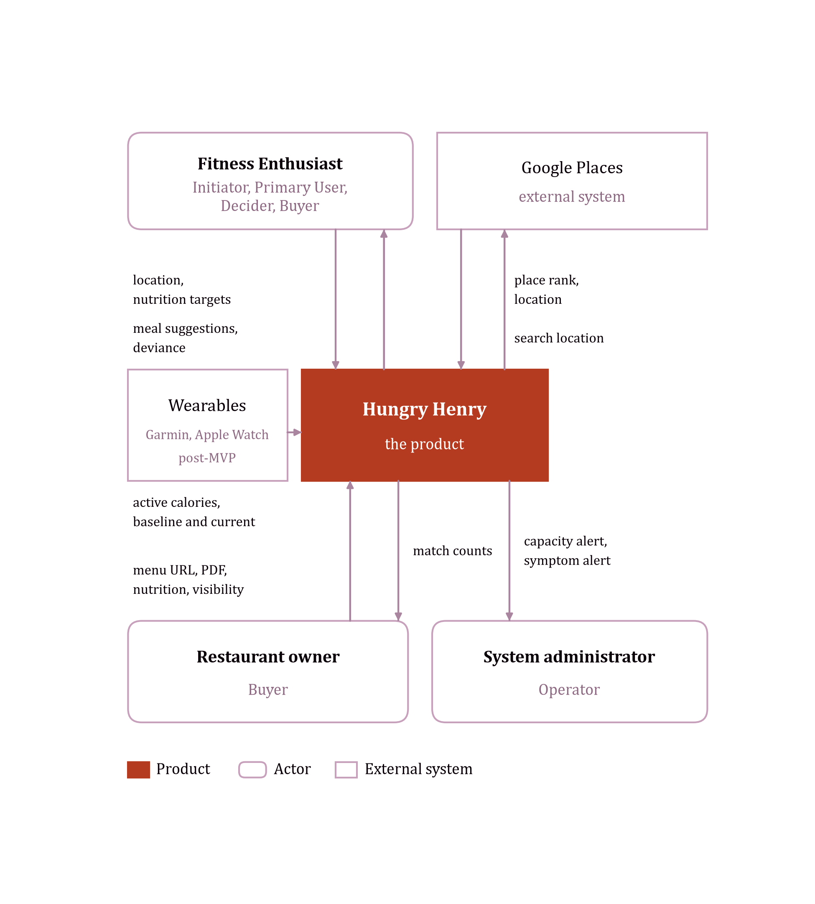
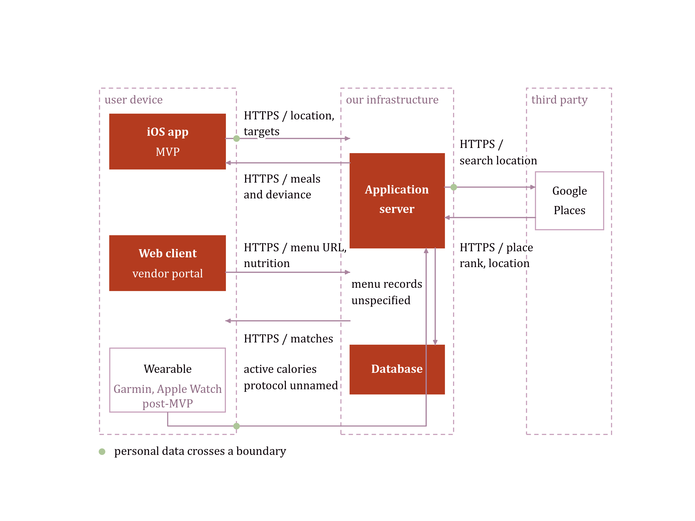

# Requirements Workbook

**Product:** Hungry Henry — Restaurant Discovery App
**Prepared by:** Alexander Voller
**Course:** 17-627 Requirements for Embedded Systems
**Document version:** 0.2 (Draft)
**Date:** 30 October 2026

## Version History

| Version | Date | Change |
| --- | --- | --- |
| 0.1 | 2026-10-22 | Initial stub document created, matching the IEEE Std 830-1998 section skeleton. |
| 0.2 | 2026-10-30 | Filled in the full Main Document: product description, diagrams, personas, and functional and non-functional requirements, edited to house style. |

## Table of Contents

Word builds this from the headings below. The field refreshes on open, so the
section and page numbers are accurate in the submitted file.

## Main Document

### 1. Introduction

#### 1.1 Purpose

This Software Requirements Specification (SRS) defines the requirements for the Hungry Henry restaurant discovery application. It is written for the Hungry Henry product and engineering team.

#### 1.2 Scope

Hungry Henry finds a restaurant meal that fits a fitness enthusiast's nutrition targets.

In scope, across the MVP and its subsequent features: the mobile app, the web vendor portal, wearable integration, and the cloud-hosted infrastructure.

Out of scope: a general nutrition and exercise platform, food delivery, and home cooking.

#### 1.3 Abbreviations

| Abbreviation | Meaning |
| --- | --- |
| SRS | Software Requirements Specification |
| MVP | Minimum viable product |
| HMI | Human-machine interface |

#### 1.4 References

[1] Towers, S. et al. "How long do people stick to a diet resolution? A digital epidemiological estimation of weight loss diet persistence." *Public Health Nutrition*, published online 14 December 2020. New January dieters: South Beach about 3.12 weeks, Paleo about 5.32 weeks. https://doi.org/10.1017/S1368980020001597

[2] International Food Information Council. *2025 Food & Health Survey*. Online survey of 3,000 Americans aged 18 to 80, fielded 13–27 March 2025. In the past year, 57% followed a specific eating pattern or diet. The most common was high protein (23%), then mindful eating (19%), then calorie counting (15%). 70% said they try to consume protein. "Good source of protein" was the top definition of a healthy food (38%). https://ific.org/wp-content/uploads/2025-IFIC-Food-Health-Survey-Full-Report.pdf

[3] Business of Apps. "MyFitnessPal Revenue and Usage Statistics (2026)." Aggregates company data: 220 million registered users in 2024, and more than 30 million monthly active users. https://www.businessofapps.com/data/myfitnesspal-statistics/

[4] FDA. Menu labeling requirements, and 21 CFR 101.11. Calorie disclosure applies to a restaurant chain with 20 or more locations doing business under the same name and offering substantially the same menu items. An independent restaurant is not covered unless it volunteers. https://www.fda.gov/food/nutrition-food-labeling-and-critical-foods/menu-labeling-requirements

[5] Nation's Restaurant News and Restaurant Business. *2025 Restaurant Technology Outlook*. Online survey of 562 operators, January 2025. 53% of independent operators said they would definitely or probably invest in new technology in the next 12 months, against 79% of chain operators. https://5868902.fs1.hubspotusercontent-na1.net/hubfs/5868902/Resource%20Center/2025-restaurant-technology-outlook.pdf

[6] Restaurant Technology News, reporting a Paysafe survey of small and medium restaurants, 22 July 2025. 92% accept credit cards and 83% still take cash. https://restauranttechnologynews.com/2025/07/how-small-restaurants-are-serving-up-success-with-payments-technology-and-online-ordering/

[7] Alexander Voller, product outline, 29 October 2026. Source of the top-level requirements in Section 3.1.

[8] Hungry Henry prototype, P1/P2 design phase screens, 2026. Source of the prototype screenshots in Section 2.2.

[9] Hungry Henry studio engagement, context-diagram skill output, 2026. Source of the context view and the deployment view in Section 2.2.

[10] Hungry Henry Product Idea Workbook, Solution Space, Sections 1 and 5, 2026. Source of the main attributes in Section 2.3 and the non-functional requirements in Section 3.2.

[11] Jain, A., Berardone, J., and Grinberg, D. 17-627 Product Management Essentials course materials, Carnegie Mellon University, 2026. Source of the four-tier latency taxonomy (Ultra-Low, Low, Medium, High) used in Section 3.2.

[12] OWASP Foundation. *Application Security Verification Standard*, v5.0.0, May 2025. https://owasp.org/www-project-application-security-verification-standard/. Source of the Level 2 security baseline in Section 3.2.

[13] OWASP Foundation. *Mobile Application Security Verification Standard*, v2.1.0, January 2024. https://mas.owasp.org/MASVS/. Source of the mobile security baseline in Section 3.2.

### 2. Overall Description

Background that explains why Section 3's requirements exist. These are general factors, not the requirements themselves, and this section does not itself state requirements.

#### 2.1 Product Perspective

Hungry Henry is a restaurant discovery app which enables sustainable and flexible dieting practices by finding goal-compliant restaurant meals. The core problem for fitness enthusiasts is that a goal-compliant cheat meal is too hard, or impossible, to find, leading to untracked guilty meals, a loss of confidence, and diet abandonment. Today, to find a meal, a fitness enthusiast has to:

- Check individual restaurants, because common apps such as Google Maps and DoorDash do not have nutritional filters.
- Conduct a separate nutritional lookup, because most restaurants do not post nutritional values.
- Perform mental mathematics to find the best fit across the combinations of menu items and the nutrition target.

The magnitude of this problem, that rigid and inflexible eating is unsustainable for the average person, has no single honest percentage behind it: there is no reliable figure for "diet plans in America fail." What is published is how fast a new diet drops off. New January dieters in the United States held the South Beach diet for about 3.1 weeks and the Paleo diet for about 5.3 weeks before dropping off [1]. Hungry Henry's answer is that a compliant meal should be found just as quickly as any other meal, with smart substitutions and replacements, and a gamified experience that reminds the fitness enthusiast they are still hitting their goals while eating ice cream.

The market strategy is to target the find-a-restaurant-meal vertical first, before expanding into the food-delivery and home-cooking segments in later products. Swiping and finding meals is free for fitness enthusiasts; instead, Hungry Henry takes a B2B approach, with restaurants paying for increased visibility and exposure. Hungry Henry will use social media distribution channels to pursue a viral network effect on initial market entry, to capitalize on the first-mover advantage. Search history and lifetime data used in suggestions raise the switching cost, and the lovable UI and gamified experience aim to keep Hungry Henry the original and dominant product in the market.

#### 2.2 Conceptual Diagram

The pictures below are the current prototype. There is no vendor-dashboard screen in that set yet.

The two views below are taken from the studio engagement's context-diagram output [9]. The context view is the boundary. Hungry Henry is one box. Nothing inside it is drawn there. The deployment view is where the iOS client, the web client, the server, and the database sit. The two are separate on purpose. Wearables are on both, marked post-MVP. The wire protocol between the wearable and the server, and between the server and the database, is not named.

#### 2.3 Product Functions

In summary, and without the detail of Section 3:

- A fitness enthusiast sets nutritional targets, searches by restaurant or by food name, changes items on a plate and sees the deviance, widens the tolerance, and looks back at previous selections.
- A restaurant owner adds, edits, and deletes food items, raises visibility to enthusiasts nearby, and sees how many matches each suggestion got.
- A system administrator is told, on a mobile device, when capacity is critical and when user-facing behaviour looks wrong. The numeric meaning of those two conditions is not set yet. See SA-01 and SA-02.

The product's main attributes, as defined in the Product Idea Workbook [10]:

- **Search and Discovery.** Generates a restaurant plate that meets, or is close enough to, the remaining nutrition target.
- **Personalization.** Locks a restaurant or a food and rebuilds the rest of the plate around it.
- **Location and Mapping.** Shows only restaurants that currently have a match, with rating and distance.
- **Location and Proximity.** Shows distance from the fitness enthusiast on the plate and on the map.
- **Advanced Math Computations.** Shows a hit or a plus/minus diff on energy, protein, carbs, and fat.
- **Standard GenAI.** Ask Henry turns a typed sentence into a plate.
- **Collaboration and Sharing.** Sends a confirmed plate so a finished meal can bring in the next person.

#### 2.4 User Personas

Three personas, each a composite rather than an actor name.

**Chad, the tolerant, proactive tracker** (Fitness Enthusiast) meal-preps most of the week, keeps a calorie and protein target, and wants a plate that respects both without the guilt of a 300 kcal miss. He represents the smaller but real tracking population, who favour high-protein patterns and logging apps such as MyFitnessPal [2][3].

**Sam, the casual healthy eater** (Fitness Enthusiast) keeps no calorie goal and types a rough target into a form, reflecting the larger population who follow a qualitative rule such as mindful eating rather than a number [2]. Sam needs a plate that looks like a fit without doing nutrition homework first.

**Bruce, the entrenched restaurant owner** (Restaurant Owner) does not know his menu's calorie values, is not comfortable on a computer, and still runs a cash-and-card register. Independents like Bruce are slower to adopt new technology than chains, though cash-only is the tail of that population, not its average [4][5][6]. The vendor portal has to work for Bruce without assuming a structured menu or a card reader.

#### 2.5 Conceptual System Model and HMI

Hungry Henry consists of a cloud-hosted web application and a mobile application. The web application is used primarily by restaurant owners and system administrators, for the convenience of a desktop viewport, though this functionality is also available on the mobile application. The primary HMI is the mobile app, used by fitness enthusiasts to find a meal.

Cloud hosting is chosen so that Hungry Henry spends developer resources on product iteration, rather than on self-hosted infrastructure and maintenance.

Internal system requirements will be fleshed out in design, but will likely feature a web frontend, a mobile frontend, an API or web service, and a database service.

#### 2.6 Sensing Capabilities

For advanced features, post-MVP, there is scope to implement automatic calorie banking and exercise compensation: the ability to compensate for a restaurant meal through increased exercise. This requires sensing a user's baseline and current active calories through a wearable such as a Garmin or an Apple Watch.

#### 2.7 Environment Conditions

The service is hosted in a typical commercial data centre, with appropriate power and cooling. How much physical compute this requires is not yet known. This needs an estimate before a machine count can be set.

#### 2.8 Constraints

TBA.

### 3. Specific Requirements

Should contain all software requirements to a level of detail sufficient to enable designers to design a system satisfying those requirements, and testers to test that it does. Minimum coverage: every input, every output, and every function performed in response to input or in support of output. Every requirement is uniquely identifiable, cross-referenced to its source, worded with the "shall" convention, and organized for readability.

The numbers in this section are local to these tables, not permanent requirement IDs. Alexander Voller's product outline, dated 29 October 2026, is the source of every requirement in 3.1 [7].

#### 3.1 Functional Requirements

##### 3.1.1 Meal Search and Discovery

| ID | Priority | Requirement |
| --- | --- | --- |
| FE-01 | Essential | When the fitness enthusiast opens the app, the system shall accept that enthusiast's nutritional targets. |
| FE-02 | Essential | When the fitness enthusiast searches for meals, the system shall return meals from a named restaurant. |
| FE-03 | Essential | When the fitness enthusiast searches for meals, the system shall return meals by food-item name. |
| FE-04 | Essential | When the fitness enthusiast selects a meal, the system shall show the deviance from the nutritional target as that enthusiast changes an individual food item, including an entree or a main. |
| FE-05 | Essential | When the fitness enthusiast selects a meal, the system shall apply a wider tolerance and show suggestions inside that wider range. |
| FE-06 | Essential | When the fitness enthusiast searches for meals, the system shall show that enthusiast's previous selections. |

##### 3.1.2 Restaurant Management

| ID | Priority | Requirement |
| --- | --- | --- |
| RO-01 | Essential | When the restaurant owner views the restaurant dashboard, the system shall add, edit, and delete food items. |
| RO-02 | Essential | When the restaurant owner views the restaurant dashboard, the system shall increase the visibility of suggestions to fitness enthusiasts in that restaurant's area. |
| RO-03 | Essential | When the restaurant owner views the restaurant dashboard, the system shall show the number of matches for each suggestion at that restaurant. |

##### 3.1.3 System Maintenance

| ID | Priority | Requirement |
| --- | --- | --- |
| SA-01 | Essential | When infrastructure is at critical capacity, the system shall notify the system administrator on a mobile device. |
| SA-02 | Essential | When abnormal user-facing symptoms are observed, the system shall notify the system administrator on a mobile device. |

"Critical capacity" and "abnormal user-facing symptoms" are not yet numbers. Alexander Voller owns both. Each needs a metric and a threshold before SA-01 or SA-02 can be tested.

#### 3.2 Non-Functional Requirements

The requirements below are drawn from the Product Idea Workbook's Solution Space [10], organized by ISO/IEC 25010 characteristic, with latency measured against the course's own four-tier taxonomy [11]. They have not been measured on a build.

Latency classes, per the course materials [11]:

| Class | Target |
| --- | --- |
| Ultra-Low | Less than 2 ms |
| Low | 2 ms to 200 ms |
| Medium | 200 ms to 1 second |
| High | 1 second to 4 seconds |

| ID | Category | Priority | Requirement |
| --- | --- | --- | --- |
| NFR-01 | Performance Efficiency – Latency | Essential | When the fitness enthusiast opens the app on the happy path, the system shall display meal suggestions within the ultra-low latency class. |
| NFR-02 | Performance Efficiency – Latency | Essential | When the fitness enthusiast searches for meals, the system shall return initial options within the medium latency class. |
| NFR-03 | Performance Efficiency – Latency | Essential | When the fitness enthusiast swipes, the system shall display a new meal suggestion within the low latency class. |
| NFR-04 | Reliability – Availability | Essential | The system shall experience less than 1 hour of downtime per year. |
| NFR-05 | Usability | Essential | Hungry Henry shall enable a first-time fitness enthusiast to confirm a plate within 3 minutes without prior instruction. |
| NFR-06 | Compatibility | Essential | The iOS app shall operate on an iPhone running the current iOS release and the two previous major releases. |
| NFR-07 | Security | Essential | No security regulation specific to this product applies; the system shall meet OWASP ASVS Level 2 for its backend and API [12], and the OWASP MASVS baseline for its iOS client [13], sized to a medium security level: the risk of an organized hacker group rather than a nation-state actor. |
| NFR-08 | Security – Privacy | Essential | The system shall treat location, nutrition targets, diet, and allergy data as personal information falling under CCPA/CPRA and comparable state law. |
| NFR-09 | Functional Suitability – Correctness | Essential | When a menu line posts an energy value, the system shall display that posted value rather than an estimate. |
| NFR-10 | Functional Suitability – Correctness | Essential | When an energy or macro value is taken from USDA FoodData Central rather than a posted menu line, the system shall mark that value as estimated. |
| NFR-11 | Safety | Essential | When a menu line posts an allergen, the system shall display that allergen on the plate. |
| NFR-12 | Compatibility – Interoperability | Essential | The system shall retrieve place identity, rating, and distance from Google Places. |
| NFR-13 | Compatibility – Interoperability | Essential | The system shall retrieve reference nutrient values from USDA FoodData Central when a menu line is nutritionally incomplete. |

##### Testability

ISO/IEC 25010 places testability under Maintainability: how easily a test can be designed and run to show the system meets its requirements. Hungry Henry's two live external dependencies, Google Places and USDA FoodData Central, make this concrete rather than abstract, since a test that calls either service directly is slow, flaky, and outside the author's control.

| ID | Priority | Requirement |
| --- | --- | --- |
| NFR-14 | Essential | The system shall be designed so that every essential user flow is tested before a version is deployed. |
| NFR-15 | Essential | The system shall isolate the Google Places and USDA FoodData Central integrations behind an interface that a test can substitute, so that plate generation is testable without a live call to either service. |
| NFR-16 | Essential | A version of the system shall pass a human approval gate before it is released. |

#### 3.3 Design Constraints

| ID | Priority | Constraint |
| --- | --- | --- |
| DC-01 | Essential | The mobile client shall be built for iOS; Android is out of scope for this product [10]. |
| DC-02 | Essential | The system shall run on public cloud infrastructure rather than self-hosted or on-premises hardware, per Section 2.5. |

#### 3.4 External Interface Requirements

TBA.

### Appendixes

TBA.

### Index

TBA.
