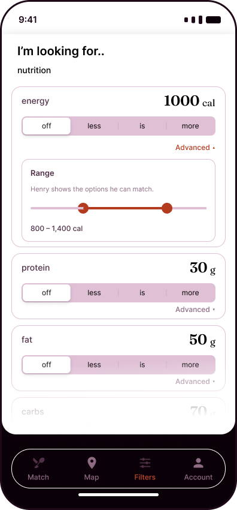
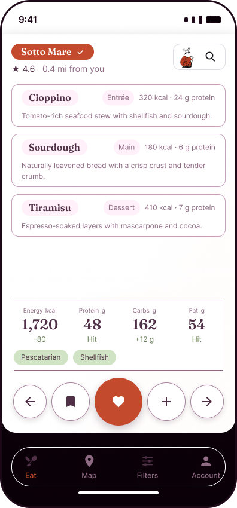
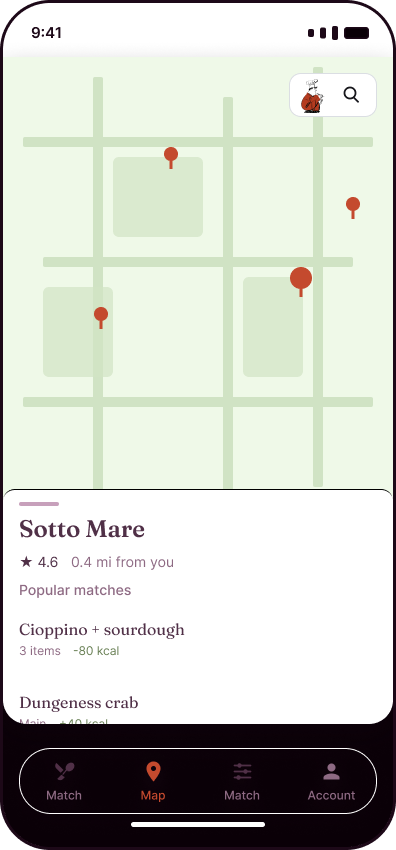

# Requirements Workbook

**Product:** Hungry Henry - Restaurant Discovery App
**Prepared by:** Alexander Voller
**Course:** 17-627 Requirements for Embedded Systems
**Document version:** 0.3
**Date:** 5 November 2026

## Version History

| Version | Date | Change |
| --- | --- | --- |
| 0.1 | 30 Oct 2026 | Checkpoint 2. Main Document: product description, conceptual and system diagrams, personas, and functional and non-functional requirements. |
| 0.2 | 3 Nov 2026 | Requirements review. Eighteen high-level requirements covering every v1 feature and actor, with 60 derived functional requirements in ISO/IEC/IEEE 29148 wording and SOPHIST sentence structure. Quality attributes defined and tied to quality requirements, with a timing and dependability analysis. Design constraints moved into their own ID-bearing table. New system concept, annotated Home HMI and vendor portal wireframe. Usability and availability targets aligned with the Product Idea Workbook. NFR-01 moved from the ultra-low to the low latency class, because no display renders a screen in under 2 ms. |
| 0.3 | 5 Nov 2026 | High-level requirements redone: HLR-01 to HLR-09 are the nine features of Section 2.3, one each, and HLR-10 to HLR-16 are the supporting functions no feature names. Every functional requirement renumbered to its parent and grouped by feature. Every requirement reviewed against the EARS and SOPHIST templates: compound requirements split, menu item used throughout, shall in place of will, constraints rewritten in the SOPHIST design-constraint template, and each missing value marked TBD with an owner. Section 2.1 gains sourced diet-adherence figures and Section 2.8 a summary of the constraints. References checked against their sources, corrected, and renumbered by first use. |

## Table of Contents

Word builds this from the headings below. The field refreshes on open, so the
section and page numbers are accurate in the submitted file.

## Main Document

### 1. Introduction

#### 1.1 Purpose

This Software Requirements Specification (SRS) defines the requirements for version 1.0 of the Hungry Henry restaurant discovery application. 

#### 1.2 Scope

Hungry Henry finds a restaurant meal that fits a fitness enthusiast's nutrition targets.

In scope, across the MVP and its subsequent features: the mobile app, the web vendor portal, wearable integration, and the cloud-hosted infrastructure. Version 1.0 is the iOS app, the vendor portal and the cloud service. Wearable integration is post-MVP: Section 3 carries it at Optional priority, and version 1.0 is not tested against it.

Out of scope: a general nutrition and exercise platform, food delivery, and home cooking.

#### 1.3 Abbreviations

The project glossary. Every term a requirement in Section 3 leans on is defined here, and each is used with this one meaning throughout.

| Term | Meaning |
| --- | --- |
| Ask Henry | The Paid feature that turns a typed sentence into a generated meal. |
| Collection | A named list of meals the fitness enthusiast has saved. |
| Deviance | A meal total minus the matching bound of the remaining nutrition target, shown as a signed number, or as "hit" when the total is inside tolerance. |
| Fitness enthusiast | A person actively pursuing a fitness or nutrition plan who still wants to eat restaurant meals. The consumer actor. |
| Menu item | One menu line: title, optional course, energy, protein, carbohydrate, fat and allergens. |
| Membership | Free, at $0, or Paid, at $10 a month, which adds target templates and Ask Henry. |
| Nine major food allergens | Milk, eggs, fish, crustacean shellfish, tree nuts, peanuts, wheat, soybeans and sesame [1]. See C-011. |
| Operational fault condition | Any of the conditions in FR-15.1, FR-15.2 or FR-15.3. |
| Remaining nutrition target | The bounds on energy, protein, carbohydrate and fat, together with the diets and allergens turned on, that a meal is judged against. |
| Restaurant drawer | The panel that shows the venue behind a generated meal. |
| Restaurant owner | The person who lists a restaurant's menu and buys its listing tier. The B2B actor. |
| Search radius | The distance from the fitness enthusiast's GPS location inside which restaurants are considered. Default 5 miles (assumption: ASM-032). |
| Target template | A remaining nutrition target saved under a name. Paid. |
| Tolerance | The allowed deviation from each bound before a total stops being a hit. 10% by default (assumption: ASM-031). |

#### 1.4 References

[1] FDA. "The FASTER Act: Sesame Is the Ninth Major Food Allergen." Sesame joined the eight major food allergens already named in federal law on 1 January 2023. https://www.fda.gov/food/food-allergies/faster-act-sesame-ninth-major-food-allergen. Used in Sections 1.3 and 3.3, C-011.

[2] Martin, C. B., Herrick, K. A., Sarafrazi, N., and Ogden, C. L. "Attempts to Lose Weight Among Adults in the United States, 2013–2016." *NCHS Data Brief* No. 313, National Center for Health Statistics, July 2018. 49.1% of US adults tried to lose weight in the past 12 months. https://www.cdc.gov/nchs/products/databriefs/db313.htm. Used in Section 2.1.

[3] International Food Information Council. *2025 Food & Health Survey*. Online survey of 3,000 Americans aged 18 to 80, fielded 13–27 March 2025. In the past year, 57% followed a specific eating pattern or diet. The most common was high protein (23%), then mindful eating (19%), then calorie counting (15%). 70% said they try to consume protein. "Good source of protein" was the top definition of a healthy food (38%). https://ific.org/wp-content/uploads/2025-IFIC-Food-Health-Survey-Full-Report.pdf. Used in Sections 2.1 and 2.4.

[4] Towers, S., Cole, S., Iboi, E., et al. "How long do people stick to a diet resolution? A digital epidemiological estimation of weight loss diet persistence." *Public Health Nutrition*, 23(18), 3257–3268, December 2020; published online 14 December 2020. New January dieters: South Beach about 3.12 weeks, Paleo about 5.32 weeks. https://doi.org/10.1017/S1368980020001597. Used in Section 2.1.

[5] Dansinger, M. L., Gleason, J. A., Griffith, J. L., Selker, H. P., and Schaefer, E. J. "Comparison of the Atkins, Ornish, Weight Watchers, and Zone Diets for Weight Loss and Heart Disease Risk Reduction: A Randomized Trial." *JAMA*, 293(1), 43–53, 2005. 160 adults, 40 per diet; 93 completed the year. Weight loss correlated with self-reported adherence (r = 0.60), not with diet type (r = 0.07). https://doi.org/10.1001/jama.293.1.43. Used in Section 2.1.

[6] Anderson, J. W., Konz, E. C., Frederich, R. C., and Wood, C. L. "Long-term weight-loss maintenance: a meta-analysis of US studies." *American Journal of Clinical Nutrition*, 74(5), 579–584, 2001. 29 studies with at least two years of follow-up; balanced low-energy diets kept 17% (95% CI 13% to 22%) of the weight lost. https://doi.org/10.1093/ajcn/74.5.579. Used in Section 2.1.

[7] Smith, C. F., Williamson, D. A., Bray, G. A., and Ryan, D. H. "Flexible vs. Rigid dieting strategies: relationship with adverse behavioral outcomes." *Appetite*, 32(3), 295–305, 1999. 223 adults; flexible dieting correlated with less overeating, lower body mass and lower depression and anxiety (r = 0.65). https://doi.org/10.1006/appe.1998.0204. Used in Section 2.1.

[8] Hungry Henry prototype, P1/P2 design phase screens, 2026. Source of the prototype screens and the base screen of the annotated Home HMI. Used in Section 2.2.

[9] Hungry Henry studio engagement, system concept and wireframes, `02-design/visuals`, 3 November 2026. Source of the system concept, the annotated Home HMI and the vendor portal wireframe. Used in Section 2.2.

[10] Hungry Henry studio engagement, context-diagram skill output, 2026. Source of the context view and the deployment view. Used in Section 2.2.

[11] Hungry Henry Product Idea Workbook, version 1.2, 5 November 2026. Solution Space, Section 1 (MVP Product Concept Outline) and Customer Value Space, Section 1 (Product Features and Benefits) are the source of the main attributes in Section 2.3, and carry the detail behind each one. Solution Space, Section 3 (Functional Requirements, user stories 1 to 22) is the source of the functional requirements in Section 3.1. Solution Space, Section 5 is the source of the quality requirements in Section 3.2. Product Strategy Space, Sections 6 and 7 (development dates, load, latency and data profiles) are the source of the capacity, data-refresh and schedule content in Sections 3.1 to 3.3. Used in Sections 2.3, 2.7, 3.1, 3.2 and 3.3.

[12] Business of Apps. "MyFitnessPal Revenue and Usage Statistics (2025)." Aggregates company data: 220 million registered users in 2024. Page as archived on 23 June 2025, https://web.archive.org/web/20250623062229/https://www.businessofapps.com/data/myfitnesspal-statistics/. Used in Section 2.4.

[13] FDA. *Menu Labeling Requirements*. Calorie disclosure applies to restaurants and similar retail food establishments in a chain of 20 or more locations, doing business under the same name and offering substantially the same menu items. An establishment outside that rule can register voluntarily (FDA Form 3757). The rule is 21 CFR 101.11. https://www.fda.gov/food/nutrition-food-labeling-and-critical-foods/menu-labeling-requirements. Used in Section 2.4.

[14] Nation's Restaurant News and Restaurant Business. *2025 Restaurant Technology Outlook*, March 2025. Online survey of 562 foodservice operators over two weeks in January 2025. 53% of independent operators said they would definitely or probably invest in new technology in the next 12 months, against 79% of chain operators. https://5868902.fs1.hubspotusercontent-na1.net/hubfs/5868902/Resource%20Center/2025-restaurant-technology-outlook.pdf. Used in Section 2.4.

[15] Gatto, R. (Paysafe). "How Small Restaurants Are Serving Up Success With Payments Technology and Online Ordering." *Restaurant Technology News*, Viewpoints, 22 July 2025. Reports a Paysafe survey of small and medium-sized businesses: 92% of the restaurants accept credit cards, and 83% still take cash. https://restauranttechnologynews.com/2025/07/how-small-restaurants-are-serving-up-success-with-payments-technology-and-online-ordering/. Used in Section 2.4.

[16] IEEE Std 830-1998. *IEEE Recommended Practice for Software Requirements Specifications*. Source of the document outline, the organizing scheme and the priority scale. Used in Section 3.1.

[17] ISO/IEC/IEEE 29148:2018. *Systems and software engineering — Life cycle processes — Requirements engineering*. Source of the "shall" keyword and the requirement-wording rules. Used in Section 3.1.

[18] Rupp, C. and the SOPHISTen. *Requirements-Engineering und -Management*, 7th ed., Carl Hanser Verlag, 2021. Source of the SOPHIST requirement templates. Used in Section 3.1.

[19] Mavin, A., Wilkinson, P., Harwood, A., and Novak, M. "Easy Approach to Requirements Syntax (EARS)." *Proceedings of the 17th IEEE International Requirements Engineering Conference*, Atlanta, 2009, pp. 317–322. https://doi.org/10.1109/RE.2009.9. Source of the EARS sentence template. Used in Section 3.1.

[20] Hungry Henry assumption log, `decisions/assumptions.md`, 2026. ASM-031 to ASM-039 are the source of every figure labelled assumption. Used in Section 3.

[21] ISO/IEC 25010:2023. *Systems and software engineering — Systems and software Quality Requirements and Evaluation (SQuaRE) — Product quality model*. Source of the quality attribute names. Used in Section 3.2.

[22] Jain, A., Berardone, J., and Grinberg, D. Product Management Essentials course materials, Sessions 11 and 12, Carnegie Mellon University, 2026. Source of the four-tier latency taxonomy: Ultra-Low, Low, Medium and High. Used in Section 3.2.

[23] Kopetz, H. *Real-Time Systems: Design Principles for Distributed Embedded Applications*, 2nd ed., Springer, 2011. Source of the deadline classes and the dependability split. Used in Section 3.2.

[24] California Civil Code §1798.130 (CCPA, as amended by CPRA). A business delivers its response to a verifiable consumer request within 45 days of receipt, extendable once by 45 days with notice. https://leginfo.legislature.ca.gov/faces/codes_displaySection.xhtml?lawCode=CIV&sectionNum=1798.130. Used in Section 3.2, NFR-13, and Section 3.3, C-010.

[25] Apple. *App Store Review Guidelines*, Section 3.1.1, In-App Purchase. An app that unlocks features or functionality, subscriptions among the examples, uses in-app purchase to do so. https://developer.apple.com/app-store/review/guidelines/. Used in Section 3.3, C-007.

[26] OWASP Foundation. *Application Security Verification Standard*, v5.0.0, published 30 May 2025. https://owasp.org/www-project-application-security-verification-standard/. Used in Section 3.3, C-008.

[27] OWASP Foundation. *Mobile Application Security Verification Standard*, v2.1.0, 18 January 2024. https://mas.owasp.org/MASVS/. Used in Section 3.3, C-009.

<!-- page-break -->

### 2. Overall Description

#### 2.1 Product Perspective

Hungry Henry is a restaurant discovery app which enables sustainable and flexible dieting practices by finding goal-compliant restaurant meals. The core problem for fitness enthusiasts is that a goal-compliant cheat meal is too hard, or impossible, to find, leading to untracked guilty meals, a loss of confidence, and diet abandonment. Today, to find a meal, a fitness enthusiast has to:

- Check individual restaurants, because common apps such as Google Maps and DoorDash do not have nutritional filters.
- Conduct a separate nutritional lookup, because most restaurants do not post nutritional values.
- Perform mental mathematics to find the best fit across the combinations of menu items and the nutrition target.

Rigid, inflexible eating is hard to keep up. Nearly half of US adults (49.1%) tried to lose weight in the past 12 months, in survey data from 2013 to 2016 [2], and 57% of Americans followed a specific eating pattern or diet in the past year in 2025 [3]. New January dieters held the South Beach diet for about 3.1 weeks and the Paleo diet for about 5.3 weeks before dropping it [4]. In a one-year randomized trial of the Atkins, Zone, Weight Watchers and Ornish diets, 67 of 160 participants (42%) stopped before the year was out. Overall adherence was low, and the weight lost tracked how closely people kept to their diet (r = 0.60), not which diet they were on (r = 0.07) [5]. Across 29 US studies with at least two years of follow-up, people who lost weight on a balanced low-energy diet kept 17% of that loss on average [6]. How a diet is held matters as well as which one: in a community sample of 223 adults, flexible dieting went with less overeating, a lower body mass and lower depression and anxiety, while calorie counting and conscious dieting went with overeating while alone and a higher body mass [7].

The market strategy is to target the find-a-restaurant-meal vertical first, before expanding into the food-delivery and home-cooking segments in later products. Swiping and finding meals is free for fitness enthusiasts; instead, Hungry Henry takes a B2B approach, with restaurants paying for increased visibility and exposure. Hungry Henry uses social media distribution channels to pursue a viral network effect on initial market entry, to capitalize on the first-mover advantage. Search history and lifetime data used in suggestions raise the switching cost, and the lovable UI and gamified experience aim to keep Hungry Henry the original and dominant product in the market.

#### 2.2 Conceptual Diagram

The pictures below are the current prototype [8]. The set has no vendor-portal screen; the vendor portal wireframe further down stands in for it until one is designed.

| Filters | Home | Restaurant drawer |
| --- | --- | --- |
|  |  |  |

The system concept is the cartoon of the whole product: the physical pieces each actor holds, the functions Hungry Henry runs in the cloud, and the external systems it depends on. Every piece carries the high-level requirement and constraint IDs from Section 3 that it serves, so the picture traces into the tables. Against version 0.1 it adds the hardware the fitness enthusiast carries (the touchscreen, the GPS receiver, the buttons and the post-MVP wearable), the restaurant owner's and the system administrator's devices, and the on-device hand-offs to Google Maps and Instagram. The cloud blocks are functions, not modules; how the service is divided is left to design.

![System concept. The devices each actor uses, the functions Hungry Henry runs in the cloud, and the external systems, labelled with their HLR and constraint IDs. [9]](visuals/system-concept.png)

The two wireframes map the HMI onto the functional requirements. The Home wireframe annotates the prototype's primary screen with the FR or NFR ID behind each control. The vendor portal wireframe is new in this version and fills the gap named above: the restaurant owner's menu, listing tier and per-item results in one desktop view.

![Home HMI, annotated. Each control on the primary screen, labelled with the requirement behind it. [9]](visuals/hmi-home-annotated.png)

![Vendor portal wireframe. The restaurant owner's menu table, import, listing tier and per-item results, keyed to their requirements. [9]](visuals/vendor-portal-wireframe.png)

The context view is the boundary. Hungry Henry is one box. Nothing inside it is drawn there. The deployment view is where the iOS client, the web client, the server, and the database sit. The two are separate on purpose. Wearables are on both, marked post-MVP. The wire protocol between the wearable and the server, and between the server and the database, is not named.

![Context view. Hungry Henry and the actors and external systems that exchange data with it. [10]](visuals/context-view.png)

![Deployment view. The mobile client, the web client, the server, and the database. [10]](visuals/deployment-view.png)

#### 2.3 Product Functions

The product's main attributes, as defined in the Product Idea Workbook [11].

- **Search and Discovery.** The primary feature. Returns meals from nearby restaurants that sit inside the remaining energy, protein, carbohydrate, and fat target, searchable by food, by restaurant name, or on the map. Diet and allergy requirements exclude everything that does not qualify, and every meal carries its venue, rating, and distance.
- **Edit meals.** Swaps, adds, and removes items across starters, mains, and desserts, scoring the running total against the target as each change is made.
- **Get directions.** Opens directions to the venue in Google from a matched meal.
- **Match.** Confirms the meal the fitness enthusiast intends to eat and saves it to the fitness enthusiast's list.
- **Save for later.** Curates collections of pre-selected meals, so a known-good meal is reachable on the next occasion.
- **Share.** Produces a summary graphic for a matched meal, sized to be overlaid onto an Instagram story.
- **Review.** Leaves a star rating and notes on a restaurant for other fitness enthusiasts.
- **Target templates.** Saves preset nutrition values as named templates and starts a search from one of them. Paid.
- **Ask Henry.** Standard GenAI: turns a typed sentence into a meal, with *try something new* and *in-season* toggles. Paid.

#### 2.4 User Personas

Three personas, each a composite rather than an actor name.

**Chad**, the **tolerant, proactive tracker** (Fitness Enthusiast), meal-preps most of the week, keeps a calorie and protein target, and wants a plate that respects both without the guilt of a 300 kcal miss; he represents the smaller but real tracking population, who favour high-protein patterns and logging apps such as MyFitnessPal [3][12].

**Sam**, the **casual healthy eater** (Fitness Enthusiast), keeps no calorie goal and types a rough target into a form, reflecting the larger population who follow a qualitative rule such as mindful eating rather than a number [3], and needs a plate that looks like a fit without doing nutrition homework first.

**Carlo**, the **entrenched restaurant owner** (Restaurant Owner), does not know his menu's calorie values, is not comfortable on a computer, and still runs a cash-and-card register; independents like Carlo are slower to adopt new technology than chains, though cash-only is the tail of that population, not its average [13][14][15]. The vendor portal has to work for Carlo without assuming a structured menu or a card reader.

#### 2.5 Conceptual System Model and HMI

Hungry Henry has one point of contact per actor, all three shown in the system concept in Section 2.2.

- **The fitness enthusiast's iPhone is the primary HMI.** The touchscreen carries every control: the Filters rows that set the remaining nutrition target; the generated meal, whose food titles are tapped to lock them; the macro row with its deviance; and five buttons under the meal (previous meal, save, Match, add, Forward), with Eat, Map, Filters and Account in the bottom navigation. The GPS receiver sets the point the search radius is measured from.
- **The restaurant owner uses the vendor portal** in a desktop web browser, for the larger viewport a menu table needs. The same functions are available on the mobile application.
- **The system administrator receives alerts** on a mobile device. There is no administrator screen in version 1.0.

Behind those, a cloud-hosted service generates and scores meals, keeps accounts, matches and menus, and watches its own health. Cloud hosting is chosen so that Hungry Henry spends developer resources on product iteration, rather than on self-hosted infrastructure and maintenance (C-002). How the service is divided internally is left to design.

#### 2.6 Sensing Capabilities

Version 1.0 senses two things, both through the iPhone: the fitness enthusiast's location, from the GPS receiver, which sets the point the search radius is measured from; and touch input on the display. It reads no other sensor.

For advanced features, post-MVP, there is scope to implement automatic calorie banking and exercise compensation: the ability to compensate for a restaurant meal through increased exercise. This requires sensing a user's baseline and current active calories through a wearable such as a Garmin or an Apple Watch (HLR-16). The sampling period for active calories is not set; it is a design decision for the release that carries HLR-16.

#### 2.7 Environment Conditions

**Typical.** The fitness enthusiast uses Hungry Henry one-handed on an iPhone, outdoors or at the restaurant table, mostly on Friday to Sunday evenings between 17:00 and 21:00 [11], over a cellular or venue Wi-Fi connection. The restaurant owner uses a desktop browser, at the venue or at home, outside service hours. The service runs in a commercial public-cloud data centre with conditioned power and cooling.

#### 2.8 Constraints

Hungry Henry is built inside six kinds of limit. Each is stated as an ID-bearing constraint in Section 3.3.

- **Platform.** iPhone and iOS only, on public cloud infrastructure (C-001, C-002).
- **External systems.** Google Places, USDA FoodData Central, Google Maps and the Instagram story format (C-003 to C-006).
- **Regulation.** Apple in-app purchase for the Paid membership, the CCPA/CPRA for personal information, and the nine major food allergens (C-007, C-010, C-011).
- **Security standards.** OWASP ASVS Level 2 for the cloud service, and OWASP MASVS for the iOS app (C-008, C-009).
- **Process.** Every version is tested, then approved by a person, before release (C-012, C-013).
- **Schedule and technology.** Development from 1 January 2027 to introduction in January 2028, and a general-purpose generative AI model for Ask Henry (C-014 to C-016).

### 3. Specific Requirements

#### 3.1 Functional Requirements

Section 3.1 is organized by feature [16]. HLR-01 to HLR-09 are the nine features of Section 2.3, in the same order and under the same names. HLR-10 to HLR-16 are the supporting functions those features depend on but do not name: the membership, the restaurant owner's menu, listing tier and insights, the menu nutrition data, the operational alerts and the post-MVP wearable. FR-NN.M is the M-th functional requirement derived from HLR-NN, and each group below holds the requirements of one HLR.

Every requirement uses "shall" in an EARS or SOPHIST sentence template [17][18][19]. Priority is the IEEE 830 scale [16]: Essential, version 1.0 is unacceptable without it; Conditional, it enhances version 1.0 but does not block it; Optional, it is post-MVP or may not be worthwhile, and version 1.0 is not tested against it. A figure labelled assumption is logged in the assumption log [20]. A TBD names what is missing and who owns it.

##### 3.1.1 High-Level Requirements

| ID | Priority | Requirement |
| --- | --- | --- |
| HLR-01 | Essential | The system shall provide the fitness enthusiast with the ability to find meals, from restaurants inside the search radius, whose energy, protein, carbohydrate and fat totals lie within tolerance of the remaining nutrition target. |
| HLR-02 | Essential | The system shall provide the fitness enthusiast with the ability to change the menu items on a meal. |
| HLR-03 | Conditional | The system shall provide the fitness enthusiast with the ability to open directions to the restaurant of a matched meal. |
| HLR-04 | Essential | The system shall provide the fitness enthusiast with the ability to match a meal, confirming it as the meal the fitness enthusiast intends to eat. |
| HLR-05 | Conditional | The system shall provide the fitness enthusiast with the ability to save meals into collections for a later occasion. |
| HLR-06 | Conditional | The system shall provide the fitness enthusiast with the ability to share a matched meal. |
| HLR-07 | Conditional | The system shall provide the fitness enthusiast with the ability to review a restaurant. |
| HLR-08 | Conditional | While the fitness enthusiast holds a Paid membership, the system shall provide the fitness enthusiast with the ability to save a remaining nutrition target as a target template. |
| HLR-09 | Conditional | While the fitness enthusiast holds a Paid membership, the system shall provide the fitness enthusiast with the ability to request a meal in a typed sentence. |
| HLR-10 | Essential | The system shall provide the fitness enthusiast with the ability to hold either a Free or a Paid membership. |
| HLR-11 | Essential | The system shall provide the restaurant owner with the ability to list the restaurant's menu items. |
| HLR-12 | Essential | The system shall provide the restaurant owner with the ability to choose the restaurant's listing tier. |
| HLR-13 | Essential | The system shall provide the restaurant owner with the ability to view the number of times each of the restaurant's menu items is shown and matched. |
| HLR-14 | Essential | The system shall assign energy, protein, carbohydrate and fat values to every menu item it shows. |
| HLR-15 | Essential | When an operational fault condition is met, the system shall send an alert to the system administrator's mobile device. |
| HLR-16 | Optional | The system shall adjust the remaining energy target by the active calories a connected wearable reports. |

##### 3.1.2 Search and Discovery

Derived from HLR-01.

| ID | Priority | Requirement |
| --- | --- | --- |
| FR-01.1 | Essential | The system shall provide the fitness enthusiast with the ability to set a bound on each of energy, protein, carbohydrate and fat, where each bound is one of: off, less than a value, equal to a value, or more than a value, with energy in kilocalories and the other three in grams. |
| FR-01.2 | Essential | The system shall provide the fitness enthusiast with the ability to turn on any of the following diets: [TBD: the supported diet list. Owner: Alexander Voller. Needed before the design review, because FR-01.2 and FR-01.6 cannot be tested without it.] |
| FR-01.3 | Essential | The system shall provide the fitness enthusiast with the ability to turn on any of the nine major food allergens. |
| FR-01.4 | Conditional | When the fitness enthusiast reopens the app, the system shall restore the remaining nutrition target last set on that device. |
| FR-01.5 | Essential | When the fitness enthusiast confirms a remaining nutrition target, the system shall generate a meal of menu items from one restaurant inside the search radius, in which every energy, protein, carbohydrate and fat total that has a bound lies within tolerance of that bound. |
| FR-01.6 | Essential | When a diet is turned on, the system shall leave out of every meal and every search result each menu item that breaks that diet. |
| FR-01.7 | Essential | When an allergen is turned on, the system shall leave out of every meal and every search result each menu item for which the restaurant lists that allergen. |
| FR-01.8 | Essential | When an allergen is turned on and the restaurant lists no allergen information for a menu item on a meal, the system shall mark that menu item as having no allergen information. |
| FR-01.9 | Essential | The system shall display, on every meal, the restaurant's name, its star rating and its distance from the fitness enthusiast's location. |
| FR-01.10 | Essential | The system shall display, on every meal, the energy, protein, carbohydrate and fat totals, each with its deviance from the remaining nutrition target. |
| FR-01.11 | Conditional | The system shall provide the fitness enthusiast with the ability to set the tolerance to a value from 10% to 25% (assumption: ASM-031). |
| FR-01.12 | Essential | If no meal from a restaurant inside the search radius has every bounded total within tolerance, the system shall display the meal with the smallest sum of absolute deviances, each deviance taken as a percentage of its bound. |
| FR-01.13 | Essential | If a displayed meal has a total outside tolerance, the system shall mark that meal as outside tolerance. |
| FR-01.14 | Essential | The system shall provide the fitness enthusiast with the ability to search for meals by restaurant name. |
| FR-01.15 | Essential | The system shall provide the fitness enthusiast with the ability to search for meals by menu item name. |
| FR-01.16 | Conditional | The system shall display the restaurant of each meal as a location on a map. |
| FR-01.17 | Conditional | The system shall provide the fitness enthusiast with the ability to set the search radius from 1 to 25 miles (assumption: ASM-032). |

##### 3.1.3 Edit meals

Derived from HLR-02.

| ID | Priority | Requirement |
| --- | --- | --- |
| FR-02.1 | Essential | The system shall display each menu item on a meal with its title, its course where the restaurant gives one, its energy and its protein. |
| FR-02.2 | Essential | The system shall provide the fitness enthusiast with the ability to lock a menu item on a meal. |
| FR-02.3 | Essential | While a menu item on a meal is locked, the system shall take every replacement menu item from that menu item's restaurant. |
| FR-02.4 | Essential | When the fitness enthusiast requests the next meal, the system shall replace every unlocked menu item on the meal. |
| FR-02.5 | Essential | When the fitness enthusiast requests the next meal, the system shall keep every locked menu item on the meal. |
| FR-02.6 | Essential | The system shall provide the fitness enthusiast with the ability to add a menu item from the meal's restaurant to the meal. |
| FR-02.7 | Essential | The system shall provide the fitness enthusiast with the ability to remove a menu item from the meal. |
| FR-02.8 | Essential | When a menu item on a meal is added, removed or replaced, the system shall display each total's recalculated deviance from the remaining nutrition target. |
| FR-02.9 | Conditional | The system shall provide the fitness enthusiast with the ability to return to the previous meal. |

##### 3.1.4 Get directions

Derived from HLR-03.

| ID | Priority | Requirement |
| --- | --- | --- |
| FR-03.1 | Conditional | When the fitness enthusiast requests directions from a matched meal, the system shall open directions from the fitness enthusiast's location to that meal's restaurant (C-005). |

##### 3.1.5 Match

Derived from HLR-04.

| ID | Priority | Requirement |
| --- | --- | --- |
| FR-04.1 | Essential | When the fitness enthusiast matches a meal, the system shall record the meal, its restaurant and the match time on the fitness enthusiast's account. |
| FR-04.2 | Essential | When the fitness enthusiast matches a meal, the system shall display the matched menu items with the meal's final totals. |
| FR-04.3 | Essential | When the fitness enthusiast starts a search, the system shall display that fitness enthusiast's previously matched meals, ordered from the latest match time to the earliest. |

##### 3.1.6 Save for later

Derived from HLR-05.

| ID | Priority | Requirement |
| --- | --- | --- |
| FR-05.1 | Conditional | The system shall provide the fitness enthusiast with the ability to create a named collection. |
| FR-05.2 | Conditional | The system shall provide the fitness enthusiast with the ability to save a meal into a collection. |
| FR-05.3 | Conditional | The system shall provide the fitness enthusiast with the ability to open a saved meal from a collection. |

##### 3.1.7 Share

Derived from HLR-06.

| ID | Priority | Requirement |
| --- | --- | --- |
| FR-06.1 | Conditional | When the fitness enthusiast shares a matched meal, the system shall produce a summary graphic of that meal in the format C-006 sets. |
| FR-06.2 | Conditional | The system shall be able to pass the summary graphic to the device's share function. |

##### 3.1.8 Review

Derived from HLR-07.

| ID | Priority | Requirement |
| --- | --- | --- |
| FR-07.1 | Conditional | The system shall provide the fitness enthusiast with the ability to rate a restaurant from 1 to 5 stars. |
| FR-07.2 | Conditional | The system shall provide the fitness enthusiast with the ability to add a text note to a restaurant rating. |
| FR-07.3 | Conditional | Wherever the system displays a restaurant's details, the system shall display the restaurant's Hungry Henry star rating with the number of ratings behind it. |

##### 3.1.9 Target templates

Derived from HLR-08.

| ID | Priority | Requirement |
| --- | --- | --- |
| FR-08.1 | Conditional | While the fitness enthusiast holds a Paid membership, the system shall provide the fitness enthusiast with the ability to save the current remaining nutrition target under a name. |
| FR-08.2 | Conditional | While the fitness enthusiast holds a Paid membership, the system shall provide the fitness enthusiast with the ability to start a search from a saved target template. |

##### 3.1.10 Ask Henry

Derived from HLR-09.

| ID | Priority | Requirement |
| --- | --- | --- |
| FR-09.1 | Conditional | When a fitness enthusiast holding a Paid membership submits a typed sentence, the system shall generate a meal in which every bounded total lies within tolerance of the remaining nutrition target and which [TBD: the test for a meal fitting the sentence, for example that it contains the dish or cuisine the sentence names. Owner: Alexander Voller. Needed before FR-09.1 can be tested.] |
| FR-09.2 | Optional | When *try something new* is on, the system shall leave out of every Ask Henry meal each menu item the fitness enthusiast has matched before. |
| FR-09.3 | Optional | When *in-season* is on, the system shall restrict Ask Henry meals to menu items marked as in season. [TBD: who marks a menu item as in season, the restaurant owner or the system; no requirement sets the mark yet. Owner: Alexander Voller.] |

##### 3.1.11 Membership

Derived from HLR-10. The membership that Target templates and Ask Henry require.

| ID | Priority | Requirement |
| --- | --- | --- |
| FR-10.1 | Essential | The system shall provide the fitness enthusiast with the ability to create an account. |
| FR-10.2 | Essential | The system shall provide the fitness enthusiast with the ability to subscribe to the Paid membership (C-007). |
| FR-10.3 | Essential | The system shall provide the fitness enthusiast with the ability to cancel the Paid membership (C-007). |
| FR-10.4 | Essential | When a fitness enthusiast without a Paid membership opens either Target templates or Ask Henry, the system shall display the Paid membership offer in place of that feature. |

##### 3.1.12 Restaurant Owner: Menu

Derived from HLR-11. The vendor portal.

| ID | Priority | Requirement |
| --- | --- | --- |
| FR-11.1 | Essential | The system shall provide the restaurant owner with the ability to add a menu item with its title, course, energy, protein, carbohydrate, fat and allergens. |
| FR-11.2 | Essential | The system shall provide the restaurant owner with the ability to edit a menu item. |
| FR-11.3 | Essential | The system shall provide the restaurant owner with the ability to delete a menu item. |
| FR-11.4 | Conditional | The system shall provide the restaurant owner with the ability to submit the address of a menu web page for import. |
| FR-11.5 | Conditional | The system shall provide the restaurant owner with the ability to upload a menu file for import in any of the following formats: [TBD: the accepted file formats. Owner: Alexander Voller.] |

##### 3.1.13 Restaurant Owner: Listing Tier

Derived from HLR-12. The vendor portal.

| ID | Priority | Requirement |
| --- | --- | --- |
| FR-12.1 | Essential | The system shall provide the restaurant owner with the ability to choose the Free, Pro Silver or Pro Gold listing tier. |
| FR-12.2 | Essential | When two meals have every bounded total within tolerance and the same sum of absolute deviances, as FR-01.12 defines it, the system shall show first the meal whose restaurant is on the higher listing tier, in the order Pro Gold, Pro Silver, Free. |

##### 3.1.14 Restaurant Owner: Insights

Derived from HLR-13. The vendor portal.

| ID | Priority | Requirement |
| --- | --- | --- |
| FR-13.1 | Essential | The system shall display to the restaurant owner, for each menu item, the number of matches that included it on each of the last 30 days. |
| FR-13.2 | Conditional | The system shall display to the restaurant owner, for each menu item, the number of meals that showed it on each of the last 30 days. |

##### 3.1.15 Menu Nutrition Data

Derived from HLR-14. The content processing and data integration pipelines in the Product Idea Workbook [11].

| ID | Priority | Requirement |
| --- | --- | --- |
| FR-14.1 | Essential | The system shall extract the title, course, published energy value and published allergens of each menu item from a restaurant's public menu. |
| FR-14.2 | Essential | When the restaurant publishes no value for a menu item's energy, protein, carbohydrate or fat, the system shall estimate that value from reference nutrient values (C-004). |
| FR-14.3 | Essential | The system shall refresh every imported menu at least once every 24 hours. |
| FR-14.4 | Essential | When the restaurant owner saves a change to a menu item, the system shall use the changed values in every meal generated after the save. |

##### 3.1.16 System Administrator: Operational Alerts

Derived from HLR-15.

| ID | Priority | Requirement |
| --- | --- | --- |
| FR-15.1 | Essential | When utilization of any production compute, memory or storage resource stays above 80% for 5 consecutive minutes, the system shall send an alert to the system administrator's mobile device (assumption: ASM-033). |
| FR-15.2 | Essential | When more than 1% of user-facing requests fail over 5 consecutive minutes, the system shall send an alert to the system administrator's mobile device (assumption: ASM-034). |
| FR-15.3 | Essential | When any of NFR-01 to NFR-03 is missed at the 90th percentile for 5 consecutive minutes, the system shall send an alert to the system administrator's mobile device (assumption: ASM-034). |

##### 3.1.17 Post-MVP: Wearable Calorie Banking

Derived from HLR-16. Planned for a later release, and not verified in version 1.0.

| ID | Priority | Requirement |
| --- | --- | --- |
| FR-16.1 | Optional | The system shall be able to read the active calories a connected wearable reports. |
| FR-16.2 | Optional | When a connected wearable reports active calories burned since the fitness enthusiast set the remaining nutrition target, the system shall raise the remaining energy target by that amount. |

#### 3.2 Non-Functional Requirements

The quality requirements below are drawn from the Product Idea Workbook's Solution Space and Technology Drivers [11]. Each is filed under a quality attribute named from ISO/IEC 25010 [21], with this product's own definition of what that attribute means and how it is measured. The attributes are categories; the NFR rows under them are the requirements. None has been measured on a build.

NFR IDs are reissued in this version. Version 0.1's interoperability rows, which named Google Places and USDA FoodData Central, are now constraints C-003 and C-004, because each names a mandated system rather than a quality. Its testability rows NFR-14 and NFR-16 described how the project is run, and are now process constraints C-012 and C-013.

Latency classes, per the course materials [22]:

| Class | Target |
| --- | --- |
| Ultra-Low | Less than 2 ms |
| Low | 2 ms to 200 ms |
| Medium | 200 ms to 1 second |
| High | 1 second to 4 seconds |

Quality attributes, as this document defines them:

| ID | Quality attribute | Definition for Hungry Henry | Measured by | Requirements |
| --- | --- | --- | --- | --- |
| QA-01 | Time behaviour | The time from an actor's action to the system's visible response. | 90th-percentile latency on a production build, from on-device instrumentation across a full evening window. | NFR-01, NFR-02, NFR-03, NFR-19 |
| QA-02 | Capacity | The number of concurrent sessions the system serves while still meeting every QA-01 requirement. | Load test at the stated concurrency. | NFR-04 |
| QA-03 | Reliability | How long the user-facing service runs between failures, and how it behaves when a dependency fails. | Incident log, mean time to failure (MTTF) over the trailing 12 months; fault-injection test. | NFR-16, NFR-18 |
| QA-04 | Availability | The share of a calendar year the user-facing service answers requests: MTTF / (MTTF + MTTR), where MTTR is the mean time to restore [23]. | External uptime probe at a 1-minute interval. | NFR-15 |
| QA-05 | Maintainability | How fast the service is restored after a failure (MTTR). | Incident log, time from first alert to restored service. | NFR-17 |
| QA-06 | Safety | Freedom from the one malign failure: a meal presented as safe for an allergy when it is not. | Test against a seeded menu set covering all nine major food allergens. | NFR-05, NFR-06 |
| QA-07 | Functional correctness | Displayed nutrition equals its source value, and every estimate says so. | Comparison against a seeded menu set with known published values. | NFR-07, NFR-08, NFR-09 |
| QA-08 | Usability | Whether a first-time fitness enthusiast finishes the core job unaided, and how fast. | Moderated usability test with at least 10 first-time participants. | NFR-10 |
| QA-09 | Security | Personal information and accounts stay confidential and unaltered by anyone not entitled to them. | Penetration test, and the verification checklists of C-008 and C-009. | NFR-11, NFR-12 |
| QA-10 | Privacy | The fitness enthusiast's control over their own personal information. | Timed deletion request on a test account. | NFR-13 |
| QA-11 | Compatibility | The range of iPhone and iOS versions the app runs on. | Test-device matrix. | NFR-14 |
| QA-12 | Testability | How easily a test shows the system meets a requirement, without calling external services. | The automated suite run with network access to external services blocked. | NFR-20 |

Categories walked and carried elsewhere: interoperability is carried by the interface constraints C-003 to C-007 and C-015, because each names a mandated external system; regulatory compliance by C-007 to C-011; and operational requirements by HLR-15 and NFR-19. Portability is empty by design, because C-001 limits version 1.0 to iOS.

| ID | Category | Priority | Requirement |
| --- | --- | --- | --- |
| NFR-01 | QA-01 Time behaviour | Essential | When the fitness enthusiast opens the app with location permission granted, a remaining nutrition target set and a network connection, the system shall display the first meal within 200 ms at the 90th percentile, the low latency class. |
| NFR-02 | QA-01 Time behaviour | Essential | When the fitness enthusiast submits a search, the system shall display the first results within 1 second at the 90th percentile, the medium latency class. |
| NFR-03 | QA-01 Time behaviour | Essential | When the fitness enthusiast requests the next meal, or adds or removes a menu item, the system shall display the updated meal with its deviance within 200 ms at the 90th percentile, the low latency class. |
| NFR-04 | QA-02 Capacity | Essential | As long as up to 1,590 sessions are open at once, the 90th-percentile response times shall be within the limits NFR-01, NFR-02 and NFR-03 set. 1,590 is the design peak for the end of the third year after introduction [11]. |
| NFR-05 | QA-06 Safety | Essential | When the restaurant lists an allergen for a menu item, the system shall display that allergen on every meal that contains that menu item. |
| NFR-06 | QA-06 Safety | Essential | The system shall display, on every meal, a notice stating that allergen information comes from the restaurant and advising the fitness enthusiast to confirm it with restaurant staff. |
| NFR-07 | QA-07 Functional correctness | Essential | When the restaurant publishes an energy value for a menu item, the system shall display that published value in place of any estimate, for 100% of such menu items. |
| NFR-08 | QA-07 Functional correctness | Essential | When the system estimates a nutrient value from reference nutrient values, the system shall mark that value as estimated, for 100% of estimated values. |
| NFR-09 | QA-07 Functional correctness | Essential | The system shall display each meal total as the sum of its menu items' values, rounded to the nearest whole kilocalorie for energy and the nearest whole gram for protein, carbohydrate and fat. |
| NFR-10 | QA-08 Usability | Essential | The system shall enable 90% of first-time fitness enthusiasts to match a meal within 1 minute of opening the app, without prior instruction. |
| NFR-11 | QA-09 Security | Essential | The system shall render personal information unreadable to unauthorized individuals, at rest and in transit. |
| NFR-12 | QA-09 Security | Essential | The system shall restrict access to a fitness enthusiast's account data to that fitness enthusiast's authenticated session. |
| NFR-13 | QA-10 Privacy | Essential | When a fitness enthusiast submits a verified request to delete their account, the system shall delete that fitness enthusiast's personal information within 45 days [24]. |
| NFR-14 | QA-11 Compatibility | Essential | The iOS app shall be designed in a way that it can be operated on an iPhone running the current major iOS release or either of the two previous major releases. |

##### Timing and Dependability

Hungry Henry has no hard real-time component: no control loop and no actuator. Its timing requirements are soft deadlines in Kopetz's sense [23], where a late result still has value. A meal shown at 3 seconds is worse than one shown at 1 second, but it is still a meal. Missing a deadline costs the position-to-own, a low time to a decision, not safety. The one malign failure in the product, an allergen shown as absent when it is present, is not a timing failure, and is covered by NFR-05, NFR-06, FR-01.7 and FR-01.8 rather than by a deadline.

| Requirement | Deadline class | What a late result costs |
| --- | --- | --- |
| NFR-01 | Soft | The fitness enthusiast waits at the table on a blank screen, the experience the product replaces. |
| NFR-02 | Soft | Search feels slower than Google Maps; the results are still valid. |
| NFR-03 | Soft | Swiping feels sluggish; the next meal is still valid. |
| NFR-19 | Soft | An outage runs longer before anyone acts. |
| FR-14.3 | Soft | A stale menu can show a menu item the restaurant no longer serves. |

Dependability is split into its three measurable parts, and they agree arithmetically: availability = MTTF / (MTTF + MTTR) [23]. With an MTTR of 1 hour (assumption: ASM-035), 99.9% availability requires an MTTF of at least 999 hours, about 42 days between user-facing failures.

| ID | Category | Priority | Requirement |
| --- | --- | --- | --- |
| NFR-15 | QA-04 Availability | Essential | The system shall keep the user-facing service available for at least 99.9% of each calendar year, at most 8.76 hours of downtime [11]. |
| NFR-16 | QA-03 Reliability | Essential | The user-facing service shall run for a mean of at least 999 hours between failures. |
| NFR-17 | QA-05 Maintainability | Essential | The mean time to restore the user-facing service shall be at most 1 hour from the first alert (assumption: ASM-035). |
| NFR-18 | QA-03 Reliability | Essential | If an external data source does not respond within 1 second and that source's last stored data is no more than 24 hours old, the system shall generate meals from that stored data (assumption: ASM-039). [TBD: the behaviour when the stored data is more than 24 hours old. Owner: Alexander Voller.] |
| NFR-19 | QA-01 Time behaviour | Essential | When an operational fault condition is met, the system shall deliver the alert to the system administrator's mobile device within 60 seconds (assumption: ASM-036). |

##### Testability

ISO/IEC 25010 places testability under maintainability [21]: how easily a test can be designed and run to show the system meets its requirements. Hungry Henry's two live external data sources, Google Places and USDA FoodData Central, make this concrete rather than abstract, since a test that calls either service directly is slow, flaky, and outside the author's control.

| ID | Category | Priority | Requirement |
| --- | --- | --- | --- |
| NFR-20 | QA-12 Testability | Essential | The system shall be designed in a way that an automated test can verify every Essential functional requirement in Section 3.1 with each external data source named in C-003 and C-004 replaced by a test substitute. |

#### 3.3 Design Constraints

A constraint limits the solution space; a quality requirement limits how well a behaviour performs. Every row below passes the first test. IDs use the C-NNN series, distinct from the requirement IDs, and the notes name the type and what each constraint bounds.

| ID | Constraint | Source | Notes |
| --- | --- | --- | --- |
| C-001 | The mobile client shall be designed in a way that it can be operated on iPhone under iOS. | [11] Solution Space, Section 1 | Business. Android is out of scope for version 1.0. Bounds HLR-01 to HLR-10. |
| C-002 | The system shall be designed in a way that it can be operated on public cloud infrastructure. | [11] Solution Space, Section 1; Section 2.5 | Business. No self-hosted or on-premises hardware. |
| C-003 | The system shall be designed in a way that it can comply with Google Places as the source of venue identity, star rating and distance, under the Google Maps Platform terms. | [11] Solution Space, Section 1 | Interface. Bounds FR-01.9 and FR-01.16. |
| C-004 | The system shall be designed in a way that it can comply with USDA FoodData Central as the source of reference nutrient values, with the attribution USDA requests. | [11] Solution Space, Section 1 | Interface. Public domain. Bounds FR-14.2. |
| C-005 | The system shall be designed in a way that it can comply with Google Maps as the application that opens directions. | [11] Solution Space, Section 1, Get directions | Interface. Bounds FR-03.1. |
| C-006 | The system shall be designed in a way that it can comply with the Instagram story format, 1080 × 1920 pixels at 9:16, for the share graphic. | [11] Solution Space, Section 1, Share | Interface format. The pixel size is assumption: ASM-038; Meta's own specification was not confirmed. Bounds FR-06.1. |
| C-007 | The system shall be designed in a way that it can comply with Apple in-app purchase as the sales channel for the Paid membership. | [25] Section 3.1.1 | Regulatory (platform). The guideline requires in-app purchase to unlock features or functionality, and names subscriptions as an example. Bounds FR-10.2 and FR-10.3. |
| C-008 | The cloud service shall be designed in a way that it can comply with Level 2 of the OWASP Application Security Verification Standard (ASVS) v5.0.0. | [26] | Standards compliance. Sized to the risk of an organized hacker group, not a nation-state actor [11]. Verifies NFR-11 and NFR-12. |
| C-009 | The iOS app shall be designed in a way that it can comply with the OWASP Mobile Application Security Verification Standard (MASVS) v2.1.0. | [27] | Standards compliance. Verifies NFR-11. |
| C-010 | The system shall be designed in a way that it can comply with the California Consumer Privacy Act, as amended by the California Privacy Rights Act (CCPA/CPRA), for location, remaining nutrition targets, diets and allergens, each as personal information. | [11] Solution Space, Section 5; [24] | Regulatory. Whether the statutory business thresholds apply at the end of years 1 to 3 is not settled; the consumer rights are applied to every user regardless (assumption: ASM-037). Bounds NFR-13. |
| C-011 | The system shall be designed in a way that it can comply with the nine major food allergens as its allergen list. | [1] | Regulatory. FALCPA (2004) set eight; the FASTER Act added sesame from 1 January 2023. Bounds FR-01.3 and FR-01.7. |
| C-012 | The release process shall be designed in a way that it can comply with deploying a version only after every Essential functional requirement in Section 3.1 has passed its test. | Version 0.1, NFR-14 | Process. |
| C-013 | The release process shall be designed in a way that it can comply with a human approval of every version before its release. | Version 0.1, NFR-16 | Process. |
| C-014 | The development schedule shall be designed in a way that it can comply with a development start on 1 January 2027. | [11] Product Strategy Space, Section 6 | Business (time). From the EstiMate output. |
| C-015 | Ask Henry shall be designed in a way that it can be operated on a general-purpose generative AI model pre-trained on public data, without a training pipeline of its own in version 1.0. | [11] Product Strategy Space, Section 7 | Design. Bounds HLR-09. |
| C-016 | The development schedule shall be designed in a way that it can comply with introduction in January 2028. | [11] Product Strategy Space, Section 6 | Business (time). 12.8 months after C-014, from the EstiMate output. |

#### 3.4 External Interface Requirements

TBA.

### Appendixes

TBA.

### Index

TBA.
